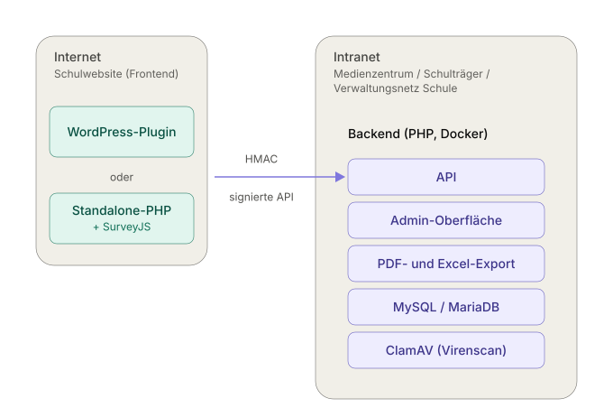
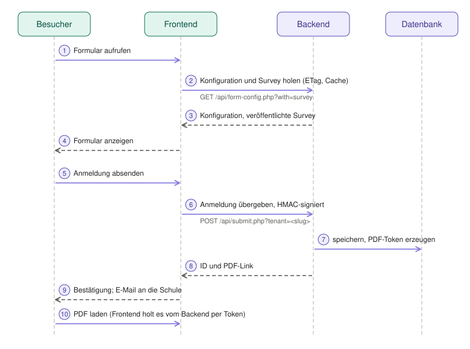
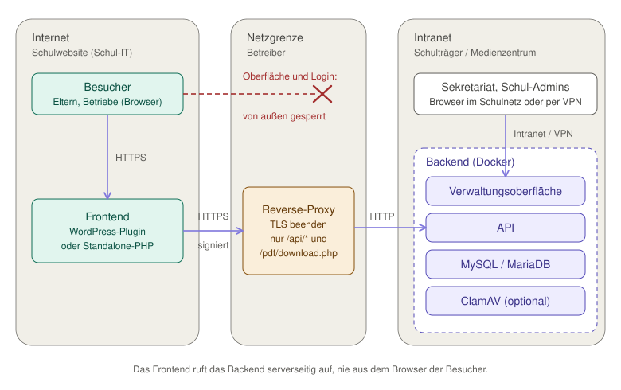

# Betriebsmodell: Backend beim Schulträger, Frontend an der Schule

Ondisos besteht aus zwei Teilen, die an verschiedenen Orten und von verschiedenen Stellen betrieben werden können:

- das **Backend** – zentral beim Schulträger oder Medienzentrum: Datenbank, Verwaltungsoberfläche, PDF- und Excel-Erzeugung, Virenscan;
- das **Frontend** – an der Schule: die Formulare auf der Schulwebsite, als [WordPress-Plugin](../../wordpress-plugin/INSTALL.md)
  oder als [Standalone-Frontend](../schul-it/standalone-frontend.md).

Dieses Dokument beschreibt, wie die beiden Seiten zusammenspielen, wer wofür zuständig ist und wie eine neue Schule angebunden wird.



## Wer macht was?

| | Betreiber des Backends (Schulträger, Medienzentrum) | Schul-IT (Website, WordPress) | Schul-Admin / Sekretariat |
|---|---|---|---|
| **Server, Updates, Backup** | Backend, Datenbank, Virenscan, Sicherung | Webserver bzw. WordPress der Schule | – |
| **Schule anlegen** | legt den Tenant an, erzeugt das Secret, übernimmt Formulare | – | – |
| **Anbindung** | nennt Backend-URL, Slug und Secret | trägt sie im Plugin bzw. in der `.env` ein, prüft den Verbindungsstatus | – |
| **Formulare** | stellt Vorlagen bereit | bettet sie per Shortcode oder Link ein | pflegt Texte, Empfänger, Logo, Survey ([Redaktion](../redaktion/SURVEYJS.md)) |
| **Anmeldungen** | – | – | bearbeitet sie im Backend ([Sekretariat](../sekretariat/README.md)) |
| **Zugänge im Backend** | legt Platform-Admin und Tenant-Admins an | – | nutzt den eigenen Zugang |

Ein **Tenant** ist eine Schule im Backend. Jede Anmeldung, jedes Formular und jedes Upload-Verzeichnis gehört zu genau einem Tenant;
Schul-Admins sehen nur ihren eigenen. Details zum Mehrschul-Betrieb: [MULTI-TENANT.md](MULTI-TENANT.md).

## Was beide Seiten verbindet

Frontend und Backend teilen genau drei Angaben. Mehr braucht es nicht:

| Angabe | Bedeutung | Wo sie herkommt |
|---|---|---|
| **Backend-URL** (`BACKEND_API_URL`) | Adresse der API, z. B. `https://backend.example.org/api` | vom Betreiber |
| **Tenant-Slug** (`TENANT_SLUG`) | Kennung der Schule, z. B. `bsz-karlsruhe` | vom Betreiber (beim Anlegen gewählt) |
| **Tenant-Secret** (`TENANT_API_SECRET`) | Schlüssel, mit dem das Frontend seine Anfragen signiert (HMAC-SHA256) | vom Betreiber (wird nur **einmal** angezeigt) |

Der Slug adressiert die Schule, das Secret **autorisiert** die Anfrage. Das Secret bleibt auf dem Server der Schule; es gelangt nie in den Browser.

## So läuft eine Anmeldung ab



Das Formular holt das Frontend mit Konfiguration und veröffentlichter Survey vom Backend (und merkt sie sich im Cache). Beim Absenden übergibt es die Angaben **signiert** ans Backend,
das sie in der Datenbank speichert und einen zeitlich begrenzten PDF-Link zurückgibt. Die Bestätigungs-E-Mail an die Schule geht vom Server des Frontends aus.
Das PDF holt das Frontend mit dem Token vom Backend und reicht es an den Besucher weiter.

## Netzwerk: was muss erreichbar sein?



Das Frontend ruft das Backend **vom Server der Schule aus** auf, nie aus dem Browser der Besucher. Besucher sprechen ausschließlich mit der Schulwebsite.
Damit gilt:

- Der **Server der Schule muss das Backend erreichen** (ausgehend, HTTPS empfohlen).
- Der **Browser der Besucher muss das Backend nicht erreichen.** Die Verwaltungsoberfläche kann im Intranet bleiben.

Das Frontend benötigt vom Backend nur diese Pfade:

| Pfad | Zweck | Von außen erreichbar? |
|---|---|---|
| `/api/form-config.php` | Konfiguration, Survey und Theme eines Formulars (`?with=survey`, ETag) | ja |
| `/api/submit.php` | Anmeldung übergeben (signiert) | ja |
| `/api/upload.php` | Datei-Upload übergeben (signiert, Virenscan) | ja |
| `/api/forms.php` | Formularliste der eigenen Schule für den Verbindungsstatus des Plugins (signiert über `forms:<slug>`) | ja |
| `/api/health.php` | Erreichbarkeit | ja |
| `/pdf/download.php` | PDF-Download per Token (30 Minuten gültig) | ja |
| alles andere (`index.php`, `forms.php`, `form_edit.php`, `form_survey.php`, `form_preview*.php`, `tenants.php`, `login.php`, `assets/` …) | Verwaltungsoberfläche | **nein, nur intern** |

Achtung beim Namen: `/api/forms.php` (öffentlich, signiert) ist nicht `/forms.php` im Wurzelverzeichnis (Admin-Seite, intern).

Liegen Frontend und Backend nicht im selben Netz, gibt es drei übliche Wege. Welcher passt, entscheiden Netzwerk und Datenschutzvorgaben des Betreibers:

1. **Gemeinsames Netz oder VPN** zwischen Schulserver und Backend: keine Veröffentlichung nötig.
2. **Reverse-Proxy** des Betreibers, der nur die oben genannten Pfade ins Internet weiterreicht; die Oberfläche bleibt gesperrt.
3. **IP-Freigabe** (Firewall oder Webserver) für die Adressen der Schulserver.

Beispiel Nginx für Weg 2 (Reverse-Proxy vor dem Backend; TLS-Teil siehe [betrieb.md](betrieb.md#https)):

```nginx
location /api/               { proxy_pass http://backend_intern; }
location = /pdf/download.php { proxy_pass http://backend_intern; }
location /                   { allow 10.0.0.0/8; deny all; proxy_pass http://backend_intern; }   # Oberfläche nur aus dem Intranet
```

Das muss stehen, **bevor** die erste externe Schule angebunden wird. Prüfen Sie von außen, dass die Oberfläche nicht erreichbar ist (`curl -I https://<backend>/login.php` muss abgewiesen werden).

Weitere Hinweise:

- **HTTPS ist Pflicht** zwischen Frontend und Backend: Die Signatur (Format 2: Zeitstempel, Nonce, Dateihash) verhindert Replay und Manipulation, schützt aber nicht vor dem Mitlesen. Die Uhren beider Server dürfen höchstens 5 Minuten abweichen ([Signaturformat](../entwicklung/sicherheit.md#signierte-api-signaturformat-2-312)).
- Die Antworten von `form-config.php` sind per Schul-Slug **ohne Signatur** lesbar (Konfiguration, veröffentlichte Surveys, auch `notify_email`): keine Geheimnisse in Formular-Konfigurationen ablegen.
- Steht WordPress selbst in Docker, ist `localhost` der Container selbst ([INSTALL.md](../../wordpress-plugin/INSTALL.md)).

### Reverse-Proxy: Pflicht, sobald das Backend nicht nur intern erreichbar ist

Der Backend-Container spricht **unverschlüsseltes HTTP** und bedient unter demselben Port auch die **Verwaltungsoberfläche** mit den Anmeldungen. Soll das Backend aus einem Netz erreichbar sein,
dem Sie nicht vollständig vertrauen (Internet, Hosting-Netz, WLAN, „halb-öffentlich" für externe Schul-Frontends), **muss ein Reverse-Proxy davor stehen**. Er
übernimmt, was das Backend nicht kann:

1. **TLS beenden** (HTTPS, gültiges Zertifikat); das Backend selbst bleibt auf HTTP.
2. **Pfade begrenzen:** nur die API-Pfade aus der Tabelle oben nach außen; alles andere (Oberfläche, `login.php`, `assets/`) nur aus dem Intranet.
3. **Header setzen:** `Host` und `X-Forwarded-Proto` (sonst erkennt `FORCE_HTTPS` die Verschlüsselung nicht), `X-Forwarded-For`.
4. **Upload-Grenze** passend zu `UPLOAD_MAX_SIZE` (Nginx: `client_max_body_size 10M`).
5. **Das Backend nur dem Proxy zeigen:** läuft der Proxy auf demselben Server, binden Sie den Backend-Port an localhost. In der Root-`.env`:

   ```bash
   BACKEND_BIND=127.0.0.1
   ```

   Danach `docker compose up -d backend`. Ohne diese Einstellung bleibt Port 9080 auf **allen** Schnittstellen offen und lässt sich am Proxy vorbei ansprechen. Läuft der Proxy auf einem anderen Server,
   sperren Sie den Port per Firewall für alle außer dem Proxy.

Ein vollständiges Nginx-Beispiel mit TLS steht in [betrieb.md](betrieb.md#https); das Beispiel für die Pfadbegrenzung oben ist mit einem echten Proxy vor dem Backend geprüft
(API und PDF-Pfad werden durchgereicht, `login.php`, `index.php`, `tenants.php` und `assets/` abgewiesen).

**Gut zu wissen:** Das Backend sieht hinter einem Proxy nur dessen Adresse. Das **Rate-Limit der Anmeldungen** (Standard: 10 pro Minute, `RATE_LIMIT_MAX` / `RATE_LIMIT_WINDOW`
in der `backend/.env`) gilt **je Besucher**: Das Frontend schickt eine pseudonyme Kennung (HMAC der Besucher-IP), sodass sich die Besucher einer Schule keinen Zähler teilen. Ein älteres Frontend ohne
diese Kennung teilt sich weiter einen Zähler pro Frontend-Server. Die IP im **Audit-Log** und das Rate-Limit der **Downloads und Editoren** gelten hinter einem Proxy ohne `TRUSTED_PROXIES` für alle gemeinsam
(siehe [Reverse-Proxy: Client-IP und Rate-Limit](betrieb.md#reverse-proxy-client-ip-und-rate-limit)).

## Verwaltungsoberfläche: Verwaltungsnetz oder Login

Die Verwaltungsoberfläche zeigt alle Anmeldungen mit personenbezogenen Daten und erlaubt Export, Löschen und das Ändern der Formulare (auch der Empfänger-Adresse der Benachrichtigungen).
Wer sie erreicht, braucht deshalb einen Schutz. Es gibt zwei Betriebsarten:

| | **Modell A: ohne Login** (`AUTH_ENABLED=false`, Einzelbetrieb) | **Modell B: mit Login** (`AUTH_ENABLED=true`; im Mehrschul-Betrieb immer) |
|---|---|---|
| Schutz | allein das **Netz**: nur wer die Seite erreicht, darf alles | Benutzername und Passwort, Sitzung, Rollen (Platform-Admin, Schul-Admin) |
| Geeignet für | **ausschließlich das Verwaltungsnetz** der Schule: das abgeschottete Netz, in dem **Sekretariat und (erweiterte) Schulleitung** arbeiten | jedes andere Netz; Pflicht, sobald das Backend nicht im Verwaltungsnetz steht |
| Rechte | **alle** Nutzer des Netzes haben dieselben Rechte (Platform-Rolle: Anmeldungen, Export, Löschen, Formular-Editor) | getrennt nach Rolle |
| Nachvollziehbarkeit | im Audit-Log steht **kein Benutzer** | Benutzername im Audit-Log |

**Was mit „Verwaltungsnetz“ gemeint ist:** ein Netz, in dem ausschließlich Geräte des Sekretariats und der (erweiterten) Schulleitung stehen und das vom Schüler-, Lehrer-, pädagogischen, Gäste- und WLAN-Netz technisch getrennt ist
(eigenes VLAN mit Firewall-Regeln, nicht nur eine andere IP-Adresse). **Jedes andere „Intranet“ ist für Modell A nicht empfohlen und gefährlich:** Im Lehrer- oder allgemeinen Schulnetz sitzen Schülerinnen und Schüler
oder Personen ohne Berechtigung im selben Netz. Wer dort die Seite aufruft, kann ohne Login alle Anmeldungen lesen, exportieren, löschen und die Benachrichtigungs-Adresse der Formulare auf ein fremdes Postfach umleiten,
ohne dass das Audit-Log einen Benutzer nennt. In solchen Netzen ist Modell B (Login) Pflicht.

**Mindestens für Modell A:**

- Das Backend steht **nur im Verwaltungsnetz** erreichbar; per Firewall ist der Zugriff auf Port 80/443 bzw. 9080 auf dieses Netz (und, für die API, auf den Frontend-Server) beschränkt.
- Die Trennung wurde **geprüft**, zum Beispiel von einem Gerät im Schülernetz: Die Seite darf dort nicht antworten.
- Fällt eine der beiden Bedingungen weg, oder ist unklar, wer das Netz erreichen kann: `AUTH_ENABLED=true` setzen ([Admin-Zugang einrichten](installation.md#4-admin-zugang-einrichten)).

Vorgemerkt für 3.1.2 ([PLAN-3.1.2.md](../entwicklung/plans/PLAN-3.1.2.md), AP2b): Eine **Netz-Allowlist** (`PLATFORM_ADMIN_ALLOWED_NETWORKS`) wird auch ohne Login erzwungen, sodass die Anwendung selbst auf das Verwaltungsnetz begrenzt.
Sie ersetzt keine Firewall, fängt aber Fehler in der Netzaufteilung ab.

## Eine neue Schule anbinden

**Betreiber (im Backend, Platform-Admin):**

1. Unter **Tenants** die Schule anlegen: Name, Slug, optional die Adresse des Frontends. Dabei **Formulare übernehmen von** einer bestehenden Schule wählen
   (ein neuer Tenant hat sonst keine Formulare).
2. Das angezeigte **Secret sofort sichern** – es erscheint nur einmal. (Verloren? *API-Schlüssel erneuern*; das alte wird ungültig.)
3. Auf der Tenant-Seite einen **Tenant-Admin** für die Schule anlegen (Benutzername, Passwort).
4. Der Schule **Backend-URL, Slug und Secret** auf einem sicheren Weg übermitteln (nicht unverschlüsselt per E-Mail) sowie die Zugangsdaten des Tenant-Admins
   getrennt davon.

**Schul-IT:**

5. [WordPress-Plugin installieren](../../wordpress-plugin/INSTALL.md) bzw. das [Standalone-Frontend einrichten](../schul-it/standalone-frontend.md) und die drei Angaben eintragen.
   Im Plugin zeigt *Einstellungen → Ondisos* den **Verbindungsstatus**: Backend erreichbar, Tenant akzeptiert, Secret passt, Zahl der Formulare.
6. Formular auf einer Seite einbinden und eine **Testanmeldung** absenden; sie muss im Backend erscheinen.

**Schul-Admin (im Backend):**

7. Unter **Formulare** pro Formular die **Empfänger-Adresse** der Benachrichtigung eintragen (beim Kopieren wird sie bewusst *nicht* übernommen), Texte
   auf die eigene Schule prüfen, Logo und Farbe der PDF-Bestätigung hochladen. Siehe [Formulare pflegen](../redaktion/SURVEYJS.md).
8. Testanmeldung löschen (Papierkorb) – dann beginnt der Echtbetrieb.

## Betrieb im Alltag

- **Backend nicht erreichbar:** Das Frontend liefert das Formular aus seinem Cache weiter (höchstens 7 Tage alte Fassung). **Absenden braucht das Backend**;
  ohne Verbindung erhalten Besucher eine Fehlermeldung. Ohne Cache erscheint eine Wartungsseite.
- **Secret erneuern** (z. B. nach Personalwechsel): im Backend *API-Schlüssel erneuern*, neuen Wert an die Schul-IT geben, dort eintragen. Bis dahin lehnt das Backend Anmeldungen ab.
- **Updates:** Backend und Frontend lassen sich getrennt aktualisieren. Das Plugin 3.1 arbeitet mit Backend 3.0 und 3.1 zusammen; Funktionen wie Surveys aus dem Backend brauchen Backend 3.1
  ([MIGRATION-3.1.md](MIGRATION-3.1.md)). Das Backend zuerst, dann die Frontends.
- **E-Mail-Benachrichtigung:** Sie wird vom **Server der Schule** versendet (PHP `mail()`) und enthält die Angaben der Anmeldung. Personenbezogene Daten laufen also
  nicht nur durch das Backend. Die Datenhaltung selbst (Datenbank, Uploads, PDFs) liegt ausschließlich im Backend.

## Vorbereitung auf die organisatorische Trennung

Wer Backend und Frontend an verschiedene Stellen gibt, sollte vorab klären und schriftlich festhalten:

- Wer erreicht wen im Netz, und über welchen der drei Wege (siehe oben)?
- Wer verwaltet die Zugänge im Backend (Tenant-Admins), wer das Secret je Schule?
- Wer informiert wen bei Updates, Wartungsfenstern und Störungen?
- Wer sichert die Daten, und wie lange werden Anmeldungen aufbewahrt (`AUTO_EXPUNGE_DAYS`, siehe [betrieb.md](betrieb.md#überwachung-und-protokolle))?
- Wer ist verantwortlich für Datenschutz-Dokumentation und Auftragsverarbeitung zwischen Schule und Betreiber?

Installation: [installation.md](installation.md). Betrieb: [betrieb.md](betrieb.md). Notfälle: [notfall.md](notfall.md).
