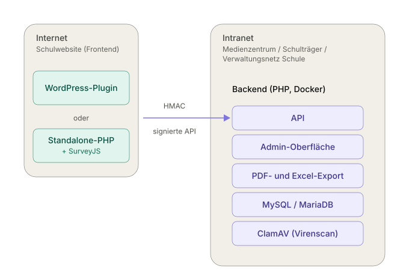
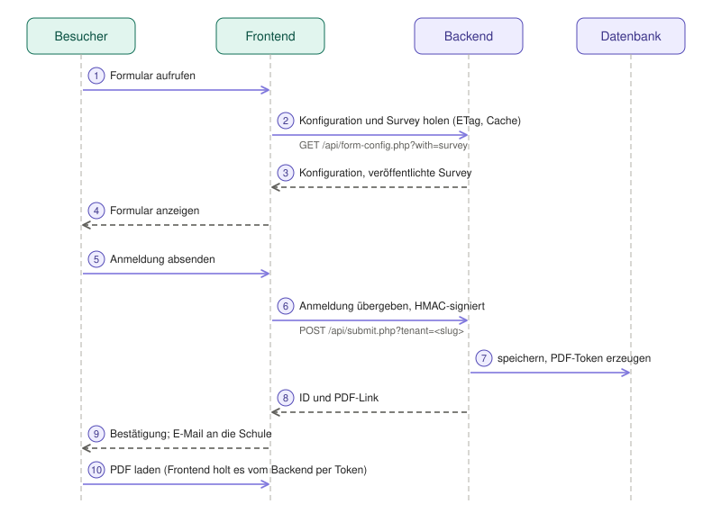

# Architektur und Datenfluss

Aufbau des Systems, Datenfluss, Datenbankschema, Funktionsumfang und Status-Ablauf. Einstieg, Tenant-Kontext und Konventionen: [Einstieg für Entwicklung](README.md).

## Architektur



### Gesamtstruktur

Die Listen nennen die wichtigsten Dateien, nicht jede. Maßgeblich ist das Verzeichnis selbst.

```
projekt/
├── frontend/                      # Öffentlich zugänglich (Standalone; das Plugin nutzt dieselben Dateien)
│   ├── public/
│   │   ├── index.php             # Formular-Anzeige (holt Config, Survey und Theme vom Backend)
│   │   ├── save.php              # Anmeldung absenden: CSRF, Honeypot, AnmeldungService
│   │   ├── ical.php              # iCal-Download (optional pro Formular)
│   │   ├── csrf_token.php
│   │   ├── pdf/download.php      # PDF-Download-Proxy (leitet zum Backend)
│   │   ├── api/messages.json.php # UI-Texte für JavaScript
│   │   ├── api/signature.php     # Unterschrift per Smartphone (3.2.0a): Relay zum Backend
│   │   ├── sign.php              # Unterschrift per Smartphone: Seite auf dem Smartphone (+ assets/sign-page.css)
│   │   ├── assets/               # SurveyJS-Laufzeit, Fonts, i18n (lokal, kein CDN)
│   │   └── js/
│   │       ├── survey-handler-base.js  # gemeinsame Basis (Standalone + WordPress), auch Dialog „Auf dem Smartphone unterschreiben“
│   │       ├── survey-handler.js       # Standalone-Handler
│   │       └── sign-page.js            # Seite auf dem Smartphone (Standalone + WordPress)
│   ├── inc/bootstrap.php         # Autoloader, .env laden
│   ├── src/
│   │   ├── Config/       FormConfig · FormConfigLoader (Config + Survey/Theme eines Formulars) · FormBundleCache (Datei-Cache, ETag, Stale-if-error) · SurveySource (Backend zuerst, sonst frontend/surveys/)
│   │   ├── Services/     AnmeldungService · BackendApiClient (signiert, hängt ?tenant= an) · SignatureRelay (3.2.0a) · EmailService · MessageService
│   │   └── Utils/        ConsentCheck (3.2.0) · Honeypot (3.1.2) · CsrfProtection · ClientIp · ContentSecurityPolicy · JsonEmbed
│   ├── config/           config-dist.php · forms-config-dist.php (Vorlage, Quelle für backend/seed-forms.php) · messages.php
│   └── surveys/          SurveyJS-Definitionen als Fallback und Importquelle (bs.json, vabo.json, …)
│
├── wordpress-plugin/              # Alternative zum Standalone-Frontend
│   ├── ondisos.php               # Plugin-Bootstrap, Shortcode [ondisos form="…"]
│   ├── includes/                 # class-shortcode, -ajax-handler, -pdf-proxy, -settings, -form-config-loader,
│   │                             # -assets, -plugin, -autoloader, -signature-handler (admin-ajax ondisos_sig / ondisos_sign)
│   ├── assets/js/survey-handler-wp.js · assets/css/ondisos.css
│   ├── frontend-assets/          # Verweis auf die gemeinsamen Frontend-Dateien
│   ├── build-zip.sh · publish-release.sh · uninstall.php · readme.txt
│   └── README.md · INSTALL.md · INSTALL-AUS-GIT.md
│
├── docs/                          # Dokumentation nach Rollen (Index: docs/README.md)
│   ├── betreiber/ · redaktion/ · sekretariat/ · schul-it/
│   ├── entwicklung/              # README.md (Einstieg), plans/, releases/, CI_CD.md, TODO.md, …
│   └── img/                      # Abbildungen und Bildschirmfotos
│
├── database/
│   ├── schema.sql                # Neuinstallation (Tenant 1 mit Platzhalter-Secret!)
│   └── migrations/               # einzelne SQL-Migrationen (add_pdf_config_column.sql, add_form_editor_tables.sql)
│
└── backend/                       # Intranet-Admin
    ├── migrate.php               # Schema auf den aktuellen Stand bringen (idempotent; Docker: bei jedem Start)
    ├── seed-forms.php            # forms-config.php → Tabelle form_configs; `[--tenant=<slug>] [<datei>|-]` (Pfad bzw. STDIN), validiert jeden Eintrag
    ├── copy-forms.php            # Formulare von Tenant zu Tenant kopieren (3.1): `--from --to [--forms] [--overwrite] [--dry-run]`
    ├── import-surveys.php        # Survey-/Theme-Dateien → Datenbank (3.1): `[--tenant=<slug>] [--overwrite] [--dry-run] <verzeichnis>`
    ├── reset-2fa.php · clear-network-restriction.php   # Notausstiege (3.1.2): Zwei-Faktor eines Admins zurücksetzen, Netz-Einschränkung eines Tenants aufheben
    ├── public/
    │   ├── index.php · detail.php · trash.php · dashboard.php
    │   ├── forms.php · form_edit.php   # Formular-Editor (3.1): Liste, anlegen, Konfiguration als HTML-Formular, Verlauf, löschen
    │   ├── form_pdf_preview.php · tenant_logo.php   # PDF-Vorschau mit Beispielangaben (GET gespeichert / POST aktuelle Formularwerte); Logo-Thumbnail
    │   ├── form_preview.php · form_preview_frame.php   # Vorschau (3.1): Entwurf/veröffentlichte Survey wie für Besucher, in einem per CSP sandboxed Frame (Markup: inc/preview_frame.php)
    │   ├── form_preview_live.php · form_preview_check.php   # Live-Vorschau (3.2, eigenes Fenster, folgt dem Editor ohne Speichern; Markup: inc/live_preview_window.php) und ihre Prüfung ungespeicherter Texte (POST, JSON)
    │   ├── form_survey.php             # Survey-Editor: Reiter Grafisch (3.2) und JSON, prüfen (mit Zeilen), Diff, Entwurf, veröffentlichen, wiederherstellen
    │   ├── themes.php · theme_edit.php # Theme-Editor (3.2.0b): Themes des Tenants mit nutzenden Formularen; Felder plus JSON, veröffentlichen (Sperre per SHA-256), Verlauf; beide Rollen
    │   ├── theme_preview_live.php · theme_preview_check.php   # Live-Vorschau des Theme-Editors (3.2.0b) und Prüfung ungespeicherter Themes (POST, JSON)
    │   ├── excel_export.php · bulk_actions.php · change_status.php
    │   ├── restore.php · hard_delete.php · download.php (Datei-Download)
    │   ├── login.php · logout.php
    │   ├── two_factor.php · two_factor_setup.php   # Zweiter Faktor (3.1.2): Code-Prüfung und Einrichtungs-Assistent, laufen auf dem Zwischenzustand pending_2fa
    │   ├── account.php           # „Mein Konto“: Status, Recovery-Codes erneuern, Faktor entfernen
    │   ├── tenants.php           # Tenant-Verwaltung (Platform-Admin), u. a. Netz-Allowlist je Tenant
    │   ├── assets/               # siehe unten
    │   ├── pdf/
    │   │   ├── download.php          # PDF per Token (ohne Session)
    │   │   └── admin_download.php    # PDF aus der Detailansicht (Admin)
    │   └── api/
    │       ├── submit.php        # Anmeldung speichern (signiert)
    │       ├── upload.php        # Datei-Upload (signiert, Virenscan)
    │       ├── form-config.php   # Formular-Konfiguration je Tenant (öffentlich per Slug); ?with=survey liefert Survey/Theme + ETag
    │       ├── forms.php         # Formular-Schlüssel des eigenen Tenants (signiert, für den Plugin-Status)
    │       ├── signature-handoff.php  # Unterschrift per Smartphone (3.2.0a): create/info/submit/poll, nur Signaturformat 2
    │       └── health.php
    ├── src/
    │   ├── Config/        Config · Database · EnvLoader · FormConfig · TenantContext · Version
    │   ├── Models/        Anmeldung · AnmeldungStatus (Enum)
    │   ├── Repositories/  AnmeldungRepository · TenantRepository · TenantAdminRepository · TwoFactorRepository (3.1.2)
    │   │                  FormConfigRepository · FormResourceRepository · FormDraftRepository · FormRevisionRepository  (3.1)
    │   │                  SignatureHandoffRepository  (3.2.0a)
    │   ├── Forms/         reine Logik ohne Datenbank (3.1 ff.):
    │   │                  Prüfen: ValidationResult · Identifiers · SurveyValidator · HtmlPolicy · ThemeValidator · SurveyLinter · FormConfigSchema · FormConfigValidator
    │   │                  Editor: FormConfigFormMapper · EditorAccess · EditorRateLimit · JsonLocator · SurveyDiff · ResourceJson · ServiceResult (+ Exceptions)
    │   │                  Grafischer Editor (3.2): SurveyBuilderRules · SurveyBuilderFindings · SurveyTemplates · SurveyBlocks · SurveyFieldExtractor
    │   │                  Übersicht und PDF: ListColumns · PdfPreviewData
    │   ├── Controllers/   AnmeldungController · DetailController · BulkActionsController · DownloadController · FormEditorController · SurveyEditorController · SurveyPreviewController · ThemeEditorController
    │   ├── Services/      Anmeldungen: AnmeldungService · StatusService · ExportService · SpreadsheetBuilder · ListColumnService · ExpungeService · RequestExpungeService · UploadCleanupService · TenantUploadCleaner · UploadPolicy · VirusScanService
    │   │                  PDF: PdfGeneratorService · PdfTemplateRenderer · PdfTokenService · PdfDownloadThrottle · PdfLogoResolver · TenantLogoService · TenantAccentColor · FormPdfAttachmentService
    │   │                  API: SignatureVerifier · HmacValidator · ReplayGuard · SecretPolicy · RateLimiter · SignatureHandoffService (3.2.0a)
    │   │                  Anmeldung am Backend: LoginService · LoginSession · LoginThrottle · AdminKey · AdminNetworkPolicy · TotpService · TwoFactorCrypto · TwoFactorLogin · TwoFactorPolicy · TwoFactorSession · RecoveryCodes
    │   │                  Formulare: FormPublishService · FormDeliveryService · SurveyImportService · FormSeedService · FormCopyService · ThemeService (3.2.0b)
    │   │                  Sonstiges: AuditLogger · MessageService · TenantDeletionPolicy · NominatimService · SchoolLookupService
    │   ├── Cli/           CliArgs · ImportSurveysCommand · CopyFormsCommand  (Logik der CLI-Skripte, testbar)
    │   ├── Validators/    AnmeldungValidator
    │   └── Utils/         ClientIp · ClientIdentity · CidrList · SafeRedirect · SessionCookie · ContentSecurityPolicy · JsonEmbed · QrCodeSvg · HelpLinks · AssetVersion · DataFormatter · FilenameSanitizer · NullableHelpers
    ├── inc/               bootstrap · auth · auth_page · csrf · header · footer
    │                      Editor-Helfer: form_editor · form_fields · form_copy · editor_diff · editor_rate_limit · survey_builder · survey_builder_tabs · theme_fields · preview_frame · live_preview_window
    ├── resources/survey-templates/   # Vorlagen, Beispiele und Bausteine des grafischen Editors (manifest.json, 3.2)
    ├── templates/pdf/     base.php · styles.css · sections/ · assets/
    ├── templates/theme/   default.json (Vorgabe-Theme im SurveyJS-3-Format, 3.2.0b)
    ├── config/            messages.php (+ messages.local.php), forms-config.php als Seed-Fallback
    ├── scripts/           generate-password-hash.php
    ├── tools/             sync-preview-assets.sh · survey-editor-bundle/ (CodeMirror) · survey-builder-harness/ (Browserprüfung) · dump-*.php (Fixtures der JS-Tests)
    ├── uploads/           tenant-<id>/ je Tenant (Dateien der Anmeldungen, branding/, forms/<form>/attachment.pdf)
    ├── logs/              audit.log
    ├── cache/             Rate-Limits, Nonces, Lauf des Auto-Expunge
    ├── docker/            Apache, PHP, Entrypoint
    ├── tests/             Unit/ · Integration/ · js/ (node --test) · fixtures/
    └── composer.json · Makefile · PDF_SETUP.md · UPLOAD_SECURITY.md · UNITTESTS.md
```

**Admin-Assets** (`backend/public/assets/`):

- `bootstrap/`, `js/admin-ui.js`: Oberfläche, lokal ausgeliefert.
- `preview/`: SurveyJS-Laufzeit für die Vorschau, eine Kopie aus dem Frontend (`tools/sync-preview-assets.sh`).
- `survey-editor.js`, `codemirror/survey-editor-cm.js`: JSON-Reiter des Survey-Editors (CodeMirror 6, MIT, vorgebaut; Quellen: `tools/survey-editor-bundle/`).
- `survey-builder/` (3.2): grafischer Editor.
  - Text und Modell: `json-doc.js`, `model.js`, `registry.js`, `names.js`, `history.js`, `text-bridge.js`.
  - Oberfläche: `ui.js`, `ui-props.js`, `conditions.js`, `dom.js`, `icons.js`, `app.js`, `builder.css`.
  - Live-Vorschau: `live-targets.js`, `live-link.js`, `live-window.js`/`.css`.
  - Tests stehen in `backend/tests/js`, die Browserprüfung in `tools/survey-builder-harness/`.
- `theme-editor.js`, `theme-editor/` (3.2.0b): Felder über dem Theme-JSON.
  - `fields.js` ist reine Logik, getestet in `backend/tests/js/theme-fields.test.mjs`. Die Oberfläche steht in `ui.js`, das Markup in `inc/theme_fields.php`.

### Tenant-Kontext

Wie `TenantContext` den aktiven Tenant bestimmt (API per Slug, Browser per Session, Platform-Admin per Tenant-Wahl, PDF per Token), steht im [Einstieg für Entwicklung](README.md#tenant-kontext).
Entscheidungen und Hintergrund: [MULTI-TENANT-DESIGN.md](MULTI-TENANT-DESIGN.md).

---

## Datenfluss




### Formular anzeigen

```
1. Browser ruft frontend/public/index.php?form=bs auf (oder eine WordPress-Seite mit [ondisos form="bs"])
   ↓
2. FormConfigLoader::ensureWithSurvey('bs') → BackendApiClient::fetchFormBundle()
   GET {BACKEND_API_URL}/form-config.php?form=bs&tenant={TENANT_SLUG}&with=survey
   Header If-None-Match: <ETag der zwischengespeicherten Fassung>
   ↓
3. Backend: Config + veröffentlichte Survey/Theme (nie Entwürfe) + ETag; unverändert ⇒ 304.
   Antwort {"success":true,"config":{…},"survey_json":"…"|null,"theme_json":"…"|null}
   Das Frontend legt sie in FormBundleCache ab (frontend/cache/forms, WordPress: uploads/ondisos-cache)
   (Formular unbekannt ⇒ 404; Backend nicht erreichbar / Tenant abgelehnt ⇒ Wartungsseite 503 bzw. im Plugin eine neutrale Meldung für Besucher und die Diagnose für Administratoren; Ursache im PHP-Log)
   ↓
4. Backend nicht erreichbar ⇒ die zwischengespeicherte Fassung (höchstens 7 Tage alt) wird ausgeliefert;
   ohne Cache ⇒ Wartungsseite 503, bei unbekanntem Formular 404, bei abgelehntem Tenant 503 (Plugin: Fehlermeldung)
   ↓
5. SurveySource: Survey/Theme aus dem Backend, sonst Datei frontend/surveys/<form>.json (Fallback wie in 3.0);
   JsonEmbed kodiert beides neu (< …), damit „</script>" im JSON nie aus dem <script>-Element ausbricht
```

### Neue Anmeldung

```
1. Besucher füllt das Formular aus
   ↓
2. JavaScript (survey-handler-base.js + survey-handler.js / -wp.js) sammelt die Daten
   ↓
3. POST an frontend/public/save.php  (WordPress: admin-ajax.php?action=ondisos_submit)
   CSRF-Prüfung (Standalone) bzw. WP-Nonce; Honeypot-Feld gefüllt ⇒ still verwerfen, Erfolg melden
   ↓
4. Frontend-AnmeldungService: Pflicht-Einwilligungen gegen die veröffentlichte Survey prüfen (ConsentCheck),
   erteilte Einwilligungen als _consents speichern, Consent-Felder aus den Daten nehmen
   ↓
5. BackendApiClient signiert mit dem Tenant-Secret (Signaturformat 2) und sendet an
   POST {BACKEND_API_URL}/submit.php?tenant={slug}
   Header: X-Timestamp, X-Nonce, X-Signature (HMAC-SHA256 über Zweck, Zeit, Nonce, Inhalt); X-Ondisos-Client (pseudonyme Besucher-Kennung)
   ↓
6. Backend: Tenant auflösen → Signatur prüfen (SignatureVerifier: Frische ±5 Minuten, Nonce nur einmal, SecretPolicy) →
   Rate-Limit je Besucher → Validierung → AnmeldungRepository speichert mit tenant_id → PDF-Token erzeugen
   ↓
7. Uploads: pro Datei POST upload.php?tenant={slug} (Signatur schließt SHA-256 der Datei ein);
   Backend prüft, dass die Anmeldung zum Tenant gehört, prüft den Inhalt (UploadPolicy), scannt mit ClamAV, speichert in uploads/tenant-<id>/
   ↓
8. EmailService (Frontend-Server) sendet die Benachrichtigung
   ↓
9. Erfolgsmeldung (+ PDF-Download-Karte) an den Besucher
```

Signaturformat und Modus `API_SIGNATURE_MODE`: [sicherheit.md](sicherheit.md#signierte-api-signaturformat-2-312).

### Unterschrift per Smartphone (3.2.0a)

Nur wenn die Formular-Konfiguration `signature_handoff: true` enthält; Plan und Entscheidungen: [PLAN-3.2.0a.md](plans/PLAN-3.2.0a.md).

```
1. Rechner: Button am signaturepad-Feld (survey-handler-base.js, setupSignatureHandoff)
   POST api/signature.php {action:create, form_key, field_name, field_title, width, height, pen_color, background_color}
   (WordPress: admin-ajax.php?action=ondisos_sig; CSRF-Token bzw. Nonce)
   ↓ SignatureRelay setzt sign_url selbst (sign.php bzw. admin-ajax.php?action=ondisos_sign)
2. Backend api/signature-handoff.php (Signaturformat 2, Zweck "signature"): prüft signature_handoff, legt Sitzung an
   (id, Hash von Schreib-Token und Lese-Schlüssel, 10 Minuten) → id, read_key, qr_svg, sign_link (= sign_url#s=<id>&t=<Schreib-Token>)
   ↓
3. Smartphone öffnet sign_link; sign-page.js liest s/t aus dem Fragment
   info  → Schule, Formular- und Feldtitel, Maße, Farben, Restlaufzeit; Status "scanned"
   submit → PNG prüfen (GD: neu kodieren), Status "signed" (nur einmal)
   ↓
4. Rechner: poll alle 3 s (Lese-Schlüssel) → open | scanned | signed (+ PNG, Sitzung wird gelöscht) | expired
   ↓
5. Vorschau → „Übernehmen“ setzt question.value; Absenden wie jede Anmeldung (submit.php)
```

### Arbeit im Backend

```
1. Login (Pflicht bei MULTI_TENANT_ENABLED=true; sonst Standard, abschaltbar nur ausdrücklich mit AUTH_ENABLED=false)
   - Platform-Admin (ADMIN_USERNAME/ADMIN_PASSWORD_HASH): verwaltet Tenants unter tenants.php und arbeitet nach der Tenant-Wahl in genau einem Tenant
   - Tenant-Admin (Tabelle tenant_admins): sieht nur den eigenen Tenant
   - Netz-Allowlist (PLATFORM_ADMIN_ALLOWED_NETWORKS bzw. tenants.admin_allowed_networks), Sperre nach Fehlversuchen (LoginThrottle),
     zweiter Faktor per Authenticator-App mit Schonfrist (3.1.2, two_factor.php / two_factor_setup.php)
   ↓
2. AnmeldungController holt die Daten über das Repository (immer auf den Tenant gefiltert)
   ↓
3. Excel-Export setzt neue Anmeldungen auf "exportiert" (nur mit AUTO_MARK_AS_READ=true)
   ↓
4. Im Backend lässt sich:
   - eine Anmeldung einzeln ansehen (detail.php), mit PDF- und Datei-Download und Blättern zwischen Einträgen
   - nach Excel exportieren (excel_export.php)
   - per Sammelaktion archivieren, löschen oder auf einen Status setzen (in Bearbeitung / akzeptiert / abgelehnt)
   - der Papierkorb verwalten (trash.php)
   - Formulare, Surveys und Themes pflegen (forms.php, form_survey.php, themes.php)
   Zugriffe auf Anmeldedaten und Änderungen landen im Audit-Log
```

---

## Datenbank-Schema

Maßgeblich ist `database/schema.sql` (Neuinstallation) bzw. `backend/migrate.php` (Upgrade). Hier die Kernstruktur:

```sql
CREATE TABLE tenants (
    id            INT AUTO_INCREMENT PRIMARY KEY,
    name          VARCHAR(255) NOT NULL,
    slug          VARCHAR(100) NULL,              -- adressiert den Tenant in API-Aufrufen (eindeutig)
    origin        VARCHAR(255) NULL,              -- CORS-Origin des Frontends
    admin_allowed_networks TEXT NULL,             -- 3.1.2: erlaubte Netze der Admins (CIDR, zeilenweise); NULL = keine Einschränkung
    api_secret    VARCHAR(255) NOT NULL,          -- HMAC-Secret für submit/upload
    active        TINYINT(1) DEFAULT 1,
    created_at    DATETIME DEFAULT CURRENT_TIMESTAMP
);

CREATE TABLE tenant_admins (       -- Backend-Benutzer eines Tenants
    id INT AUTO_INCREMENT PRIMARY KEY, tenant_id INT NOT NULL, username VARCHAR(100) NOT NULL,
    password_hash VARCHAR(255) NOT NULL, is_platform_admin TINYINT(1) DEFAULT 0,
    active TINYINT(1) NOT NULL DEFAULT 1, created_at DATETIME DEFAULT CURRENT_TIMESTAMP,
    UNIQUE KEY uq_tenant_username (tenant_id, username)
);

CREATE TABLE form_configs (        -- Formular-Konfiguration je Tenant
    id INT AUTO_INCREMENT PRIMARY KEY,
    tenant_id   INT NOT NULL,
    form_key    VARCHAR(100) NOT NULL,
    config_json LONGTEXT NOT NULL,       -- wie ein Eintrag in forms-config-dist.php, als JSON
    created_at DATETIME DEFAULT CURRENT_TIMESTAMP, updated_at DATETIME NULL ON UPDATE CURRENT_TIMESTAMP,
    UNIQUE KEY uq_tenant_form (tenant_id, form_key)
);

-- 3.1.2 (Zwei-Faktor-Anmeldung). admin_key = 'tenant:<tenant_admins.id>' oder 'platform:<ADMIN_USERNAME>' (der Platform-Admin liegt in der .env), kein FK
-- admin_two_factor:     totp_secret_enc (libsodium, Schlüssel TWO_FACTOR_KEY), totp_confirmed_at, last_totp_step (Replay-Schutz), grace_logins_used
-- admin_recovery_codes: nur SHA-256-Hashes, used_at = einmal verwendet
-- (Gelöschte Admins/Tenants hinterlassen unbenutzte Zeilen; die Schlüssel werden nie wiederverwendet.)

-- 3.1 (Formular-Editor, Details: docs/entwicklung/plans/PLAN-3.1.md). Alle drei sind tenant-isoliert (FK → tenants, ON DELETE CASCADE).
-- form_resources:  veröffentlichte Surveys/Themes je Tenant, UNIQUE (tenant_id, kind, name), sha256 = Versions-Token
-- form_drafts:     höchstens ein Survey-Entwurf je Formular (based_on_sha = Live-Stand beim Anlegen → Konflikterkennung)
-- form_revisions:  Historie, nur anhängen (config | survey | theme), Aufbewahrung 50 je Formular und Typ

CREATE TABLE anmeldungen (
    id INT(11) AUTO_INCREMENT PRIMARY KEY,
    tenant_id INT NOT NULL DEFAULT 1,             -- FK → tenants.id
    formular VARCHAR(100) NOT NULL,
    formular_version VARCHAR(50) NULL,
    name VARCHAR(255) NULL,
    email VARCHAR(255) NULL,
    status VARCHAR(30) DEFAULT 'neu',
    data LONGTEXT NOT NULL,                       -- JSON mit allen Formulardaten
    pdf_config LONGTEXT NULL,                     -- JSON: PDF-Konfiguration zum Zeitpunkt der Anmeldung
    created_at DATETIME DEFAULT CURRENT_TIMESTAMP,
    updated_at DATETIME NULL ON UPDATE CURRENT_TIMESTAMP,
    deleted TINYINT(1) DEFAULT 0,
    deleted_at DATETIME NULL,
    INDEX idx_tenant (tenant_id), INDEX idx_tenant_formular (tenant_id, formular),
    INDEX idx_tenant_status (tenant_id, status), INDEX idx_formular (formular),
    INDEX idx_email (email), INDEX idx_created (created_at)
) ENGINE=InnoDB DEFAULT CHARSET=utf8mb4 COLLATE=utf8mb4_unicode_ci;

-- 3.2.0a: signature_handoffs (siehe unten)
```

**Wichtige Felder:**
- `data`: JSON mit allen Formulardaten
- `status`: neu, exportiert, in_bearbeitung, akzeptiert, abgelehnt, archiviert (`AnmeldungStatus`)
- `deleted` / `deleted_at`: Soft-delete (Papierkorb)
- `tenants.api_secret`: Secret für die HMAC-Signatur; `SecretPolicy` lehnt Platzhalter/Standardwerte ab
- Tenant 1 (`slug = default`) wird bei Migration/Seed immer angelegt
- `signature_handoffs` (3.2.0a): kurzlebige Sitzungen der Unterschrift per Smartphone (`id`, `tenant_id`, `form_key`, Feldname und -titel, Maße, Farben, `write_hash`, `read_hash`, `png`, `status` open/scanned/signed,
  `created_at`/`expires_at` als Unix-Sekunden). Tokens nur als SHA-256; eine Zeile lebt höchstens 10 Minuten und wird beim Abholen, beim nächsten `create` des Tenants oder bei `migrate.php` gelöscht

Nicht in der Datenbank, sondern unter `uploads/tenant-<id>/`: die hochgeladenen Dateien, Logo und Akzentfarbe der Schule (`branding/`) und das an die PDF-Bestätigung angehängte PDF eines Formulars (`forms/<form>/attachment.pdf`).

---

## Funktionsumfang

Die Liste für Schulen und Betreiber steht in der [README](../../README.md); hier die Zuordnung zum Code.

**Mandantenfähigkeit (3.0):**
- Mehrere Schulen pro Backend-Instanz, Datenisolierung über `tenant_id` in allen Abfragen
- Platform-Admin (Zugang aus `.env`) mit Tenant-Wahl und Tenant-Verwaltung (`tenants.php`); Tenant-Admins (`tenant_admins`) sehen nur ihren Tenant
- Signierte API je Tenant (`SignatureVerifier`, Format 2 mit Zeitstempel und Nonce seit 3.1.2, Standard seit 3.2.0)
- Upload-Isolierung (`uploads/tenant-<id>/`), Audit-Log mit `tenant_id`, IDOR-Protokollierung
- Bekannte Platzhalter-/Standard-Secrets authentifizieren nichts (`SecretPolicy`)

**Formulare im Backend (3.1, 3.2):**
- Formular-Konfiguration als HTML-Formular (`FormConfigSchema`, `FormConfigFormMapper`), Verlauf in `form_revisions`
- Survey-Editor mit Entwurf, Prüfung (`SurveyValidator`, `SurveyLinter`), Diff, Vorschau und Veröffentlichung (`FormPublishService`)
- Grafischer Editor (3.2) auf demselben Text, mit Vorlagen und Bausteinen (`SurveyTemplates`, `SurveyBlocks`), Hilfe bei Bedingungen und Live-Vorschau
- Theme-Editor (3.2.0b, `ThemeService`)
- Auslieferung an das Frontend mit ETag (`FormDeliveryService`), Import aus Dateien (`SurveyImportService`), Kopie zwischen Tenants (`FormCopyService`)

**Frontend:**
- SurveyJS mit lokalen Fonts und Assets (DSGVO-konform), Standalone-PHP **oder** WordPress-Plugin
- Gemeinsame JS-Basis (`survey-handler-base.js`); Prefill per `#prefill=<base64url>` im Fragment (seit 3.2.0; ältere Links mit `?prefill=<base64>` werden weiter gelesen) oder einfachen Query-Parametern (`?Klasse=5a`), `SurveyHandlerBase::readPrefill()`
- Dynamische Platzhalter (`placeholderExpression`)
- CSRF-Schutz, Honeypot, Prüfung der Pflicht-Einwilligungen auf dem Server (`ConsentCheck`)
- Datei-Upload, Unterschrift per Smartphone (3.2.0a, siehe [Datenfluss](#unterschrift-per-smartphone-320a))
- PDF-Download nach dem Absenden (Token, per Formular konfigurierbar)

**PDF-System** (Details: [pdf-system.md](pdf-system.md)):
- On-Demand-Erzeugung mit mPDF (kein dauerhafter Speicher), DejaVu Sans für Umlaute
- Token (HMAC-SHA256, Standard 30 Minuten, je Formular einstellbar mit Obergrenze), Rate-Limit je Anmeldung, Besucher und Schule (`PdfDownloadThrottle`)
- Frontend-Proxy für den öffentlichen Zugriff (Backend bleibt im Intranet)
- Schul-Logo und Akzentfarbe je Tenant, eigene Abschnitte vor/nach der Datentabelle, Feldauswahl (Include/Exclude), Reihenfolge wie im Formular
- Angehängtes PDF je Formular (`FormPdfAttachmentService`), Vorschau mit Beispielangaben im Formular-Editor

**Backend-Verwaltung:**
- Übersicht mit Seiten, Filtern und Spalten aus der veröffentlichten Survey (`ListColumnService`)
- Status-System, Sammelaktionen, Papierkorb mit Wiederherstellen
- Excel-Export (`SpreadsheetBuilder`): Datumsformat dd.mm.yyyy, Zebrastreifen, Spaltenbreite, fixierte Kopfzeile, Metadaten-Blatt, Formular-Spalte ausgeblendet beim Export eines Formulars
- Detailansicht: erkennt URLs, E-Mail-Adressen und Datumswerte, Datei- und PDF-Download, Blättern zwischen Einträgen
- Dashboard mit Statistiken
- Auto-Expunge archivierter Anmeldungen (anfragebasiert, höchstens alle 6 Stunden)
- Virenscan beim Upload (ClamAV TCP/INSTREAM), Inhaltsprüfung (`UploadPolicy`)
- Audit-Log (JSON-Lines, `backend/logs/audit.log`): Anmeldung und Zwei-Faktor, Ansehen und Download von Anmeldedaten, Status, Export, Sammelaktionen, Uploads und Virenfunde, Formular-, Theme- und Tenant-Änderungen, IDOR-Versuche
- Login-Härtung (3.1.2): Netz-Allowlist, Sperre nach Fehlversuchen, zweiter Faktor (TOTP) mit Recovery-Codes

**Code:**
- Clean MVC mit Service Layer; reine Logik ohne Datenbank in `App\Forms` (gut testbar)
- PHP 8.2+ mit `strict_types`, typisierten Properties und `readonly`, PSR-4-Autoloading
- Konfiguration über `.env` (`EnvLoader`, `Config`)

---

## Status-Ablauf

```
neu (Anmeldung eingegangen)
  ↓ (beim Excel-Export, wenn AUTO_MARK_AS_READ=true)
exportiert
  ↓ (manuell)
in_bearbeitung
  ↓ (manuell)
akzeptiert / abgelehnt
  ↓ (manuell per Sammelaktion)
archiviert
  ↓ (AUTO_EXPUNGE_DAYS nach der letzten Änderung; 0 = aus)
[endgültig gelöscht, samt hochgeladener Dateien]
```

Unabhängig davon verschiebt „Löschen“ eine Anmeldung in den Papierkorb (`deleted = 1`); dort lässt sie sich wiederherstellen oder endgültig löschen.
