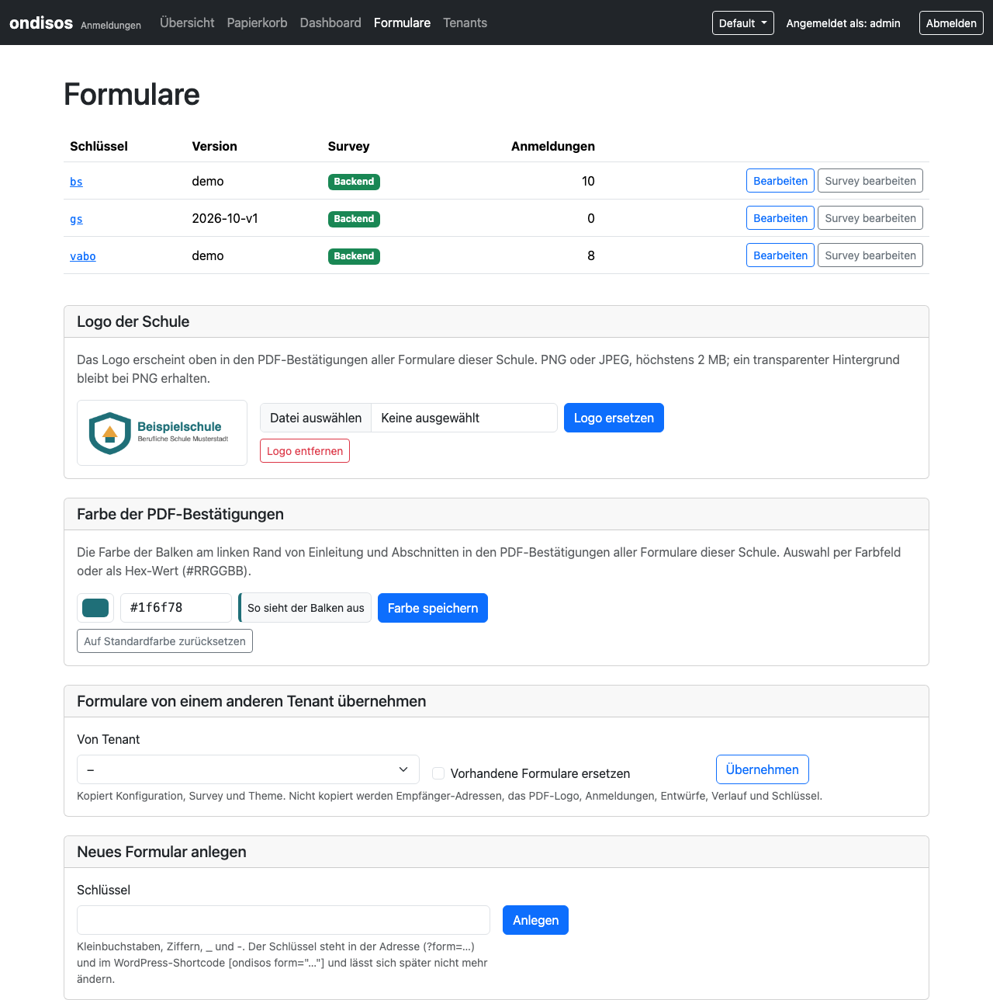
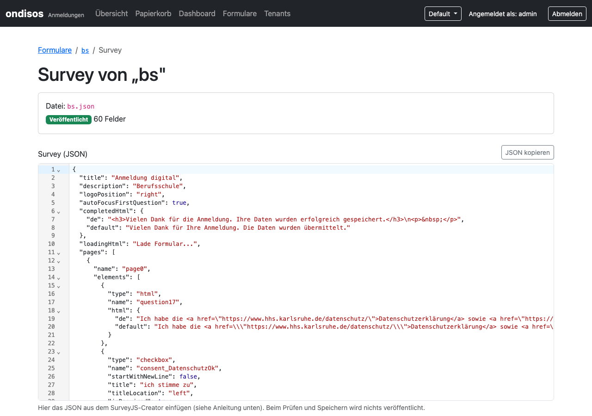
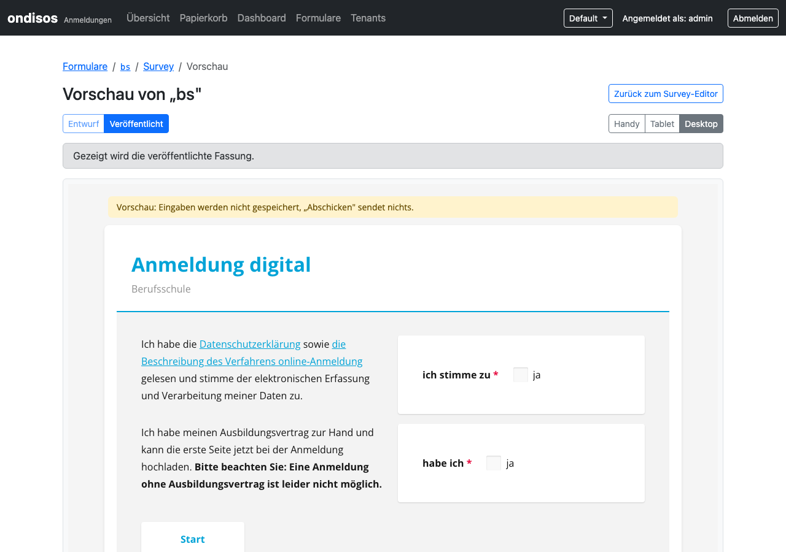
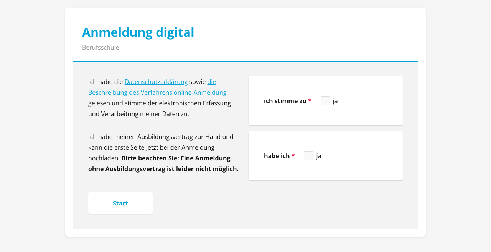
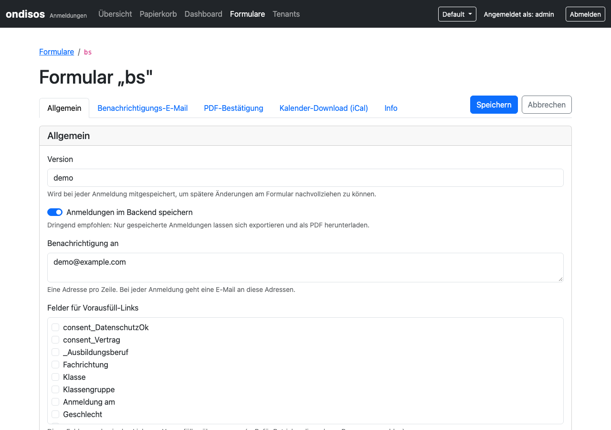
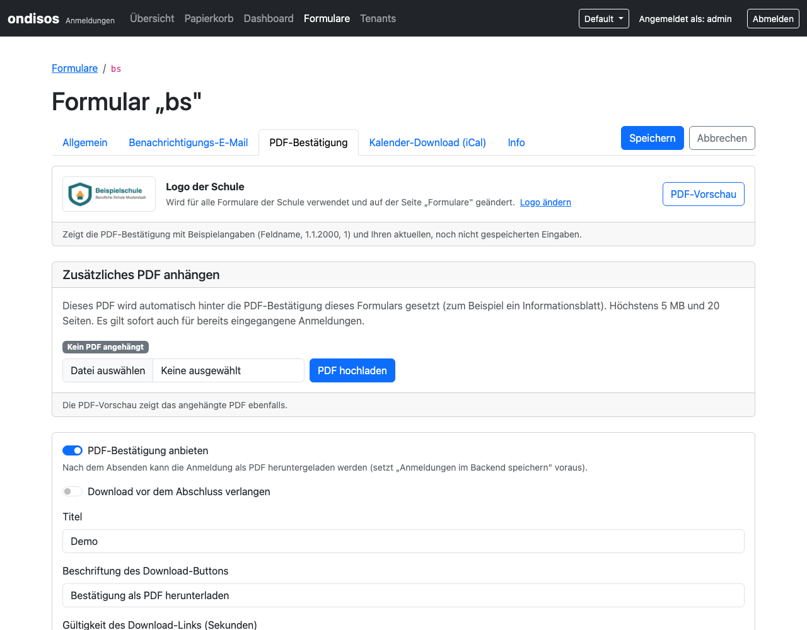

# Formulare erstellen und ändern (SurveyJS)

## Inhaltsverzeichnis

- [Überblick](#überblick)
- [Formulare entwerfen (SurveyJS Creator)](#formulare-entwerfen-surveyjs-creator)
  - [Lizenzhinweis](#lizenzhinweis)
- [Unterschriftsfelder](#unterschriftsfelder)
  - [Auf dem Smartphone unterschreiben](#auf-dem-smartphone-unterschreiben)
  - [Bestätigung ohne Unterschrift](#bestätigung-ohne-unterschrift)
- [Ausgeblendete Felder mit festem oder berechnetem Wert](#ausgeblendete-felder-mit-festem-oder-berechnetem-wert)
- [Workflow im Backend](#workflow-im-backend)
  - [Bestehendes Formular ändern](#bestehendes-formular-ändern)
  - [Was „Prüfen“ meldet](#was-prüfen-meldet)
  - [Neues Formular erstellen](#neues-formular-erstellen)
  - [Vorschau](#vorschau)
  - [Live-Vorschau](#live-vorschau)
  - [Verlauf und Wiederherstellen](#verlauf-und-wiederherstellen)
- [Design (Theme) ändern](#design-theme-ändern)
  - [Einstellungen und JSON](#einstellungen-und-json)
  - [Prüfen, Vorschau, Veröffentlichen](#prüfen-vorschau-veröffentlichen)
  - [Ältere Themes und eigene Schriften oder Bilder](#ältere-themes-und-eigene-schriften-oder-bilder)
- [Zusammenhang: Formular-Konfiguration ↔ Survey](#zusammenhang-formular-konfiguration--survey)
- [Surveys als Dateien (Fallback)](#surveys-als-dateien-fallback)

## Überblick

Ein Formular besteht aus zwei Teilen:

- der **Survey**: dem SurveyJS-JSON mit Seiten, Fragen und Texten (das, was Besucher sehen), und
- der **Formular-Konfiguration**: Empfänger der Benachrichtigung, PDF-Bestätigung, Vorausfüll-Links usw.

Beides pflegen Schul-Admins im Backend unter **Formulare** (ab Version 3.1). Surveys und Themes liegen in der Datenbank (pro Schule), das Frontend holt sie
zusammen mit der Konfiguration vom Backend.



## Formulare entwerfen (SurveyJS Creator)

Zum Entwerfen dient der Drag-and-Drop-Designer von SurveyJS, erreichbar über
https://surveyjs.io/create-free-survey

Der Creator ist **nicht Teil von Ondisos**. Das Backend enthält nur einen Code-Editor, in den das JSON aus dem Creator eingefügt wird.

### Lizenzhinweis

Die SurveyJS-Bibliothek, die Ondisos zur Anzeige der Formulare nutzt, ist quelloffen (MIT). Der **Creator** ist dagegen proprietär lizenziert; deshalb wird er
weder mitgeliefert noch in das Backend eingebunden. Für seine Nutzung gelten die Bedingungen von SurveyJS (https://surveyjs.io/licensing).

## Unterschriftsfelder

Der SurveyJS-Fragetyp `signaturepad` wird unterstützt. Die Unterschrift wird als Bild gespeichert und erscheint in der Detailansicht und in der PDF-Bestätigung; in der Excel-Ausgabe und in der Benachrichtigungs-Mail steht stattdessen der Platzhalter „[Unterschrift]“.

**Verwenden Sie das Format PNG** (`"dataFormat": "png"`, das ist die Voreinstellung von SurveyJS). Mit `"dataFormat": "jpeg"` wird der Hintergrund der Unterschrift schwarz, im Formular wie im PDF, weil JPEG keine Transparenz kennt.
SVG wird nicht angenommen.

Eine Unterschrift ist ein einfaches Bild, keine qualifizierte elektronische Signatur. Ob das für Ihren Zweck genügt, klären Sie mit Schulträger oder Datenschutzbeauftragten.

### Auf dem Smartphone unterschreiben

Mit der Maus zu unterschreiben ist mühsam. Ab 3.2.0a können Besucher am Rechner **„Auf dem Smartphone unterschreiben“** wählen:

1. Am Unterschriftsfeld erscheint ein QR-Code. Der Besucher scannt ihn mit Smartphone oder Tablet.
2. Auf dem Smartphone öffnet sich eine Seite mit Schulname, Formulartitel und dem Titel des Feldes und einer Unterschriftsfläche. Der Besucher unterschreibt und sendet.
3. Am Rechner erscheint die Unterschrift als Vorschau. Erst mit **Übernehmen** kommt sie ins Formular, **Verwerfen** erzeugt einen neuen Code.

Danach läuft alles wie bei einer Unterschrift mit der Maus (Detailansicht, PDF, Platzhalter in Excel und Mail).

**Einschalten:** *Formulare →* beim Formular *Bearbeiten →* Abschnitt *Allgemein →* „Unterschrift auf dem Smartphone anbieten“. Die Einstellung gilt für alle Unterschriftsfelder des Formulars; im Survey ändern Sie nichts.

Gut zu wissen:

- Der Button erscheint nur bei Unterschriftsfeldern im Format PNG und nur an Geräten mit Maus. Wer das Formular schon auf Smartphone oder Tablet ausfüllt, unterschreibt direkt im Feld.
- Ein QR-Code gilt **10 Minuten** und nur für eine Unterschrift. Bei mehreren Unterschriftsfeldern (z. B. Schüler/in und Erziehungsberechtigte) gibt es je Feld einen eigenen Code.
- Größe, Strich- und Hintergrundfarbe der Fläche auf dem Smartphone entsprechen dem Feld im Formular (`signatureWidth`, `signatureHeight`, `penColor`, `backgroundColor` bzw. Theme). Ein Feld im Querformat (Vorgabe 300 × 200) nutzt den Platz auf dem Smartphone am besten.
- Die Vorschau in *Formulare* zeigt den Button nicht, sie sendet nichts.
- Die Unterschrift ist dadurch **nicht rechtssicherer**: Sie bleibt ein gemaltes Bild, nur bequemer gezeichnet.

### Bestätigung ohne Unterschrift

Genügt Ihrer Schule eine Bestätigung, ist eine Checkbox mit getipptem Namen einfacher und hat denselben Beweiswert wie ein gemaltes Bild, zum Beispiel:

```json
{ "type": "checkbox", "name": "Bestaetigung", "title": "Bestätigung", "isRequired": true,
  "choices": [{ "value": "ja", "text": "Ich bestätige die Richtigkeit meiner Angaben." }] },
{ "type": "text", "name": "BestaetigtVon", "title": "Vor- und Nachname", "isRequired": true }
```

## Ausgeblendete Felder mit festem oder berechnetem Wert

Manche Angaben füllt das Formular selbst, etwa die Klasse aus der gewählten Unterrichtsform. Dafür dient ein ausgeblendetes Feld (*Sichtbar* aus) mit einem dieser Werte:

- **Vorgabewert:** ein fester Wert, z. B. `VABO`.
- **Vorgabewert durch Ausdruck** (`defaultValueExpression`): berechnet beim Öffnen und bei jeder Änderung der genannten Felder, z. B.
  `iif({Unterrichtsform} = 'Vollzeitunterricht', 'MV', 'MT')`. Eine eigene Eingabe in das Feld hätte Vorrang; bei einem ausgeblendeten Feld gibt es keine.
- **Wert setzen durch Ausdruck** (`setValueExpression`): berechnet ebenso, überschreibt aber auch eine eigene Eingabe.

Ausgeblendete Felder schickt SurveyJS normalerweise **nicht** mit: Die Einstellung *Angaben ausgeblendeter Felder* des Formulars (`clearInvisibleValues`) löscht sie
beim Absenden. Stellen Sie deshalb am Feld *Angabe, wenn ausgeblendet* auf **Behalten** (`"clearIfInvisible": "none"`):

```json
{
  "type": "text",
  "name": "Klasse",
  "visible": false,
  "defaultValueExpression": "iif({Unterrichtsform} = 'Vollzeitunterricht', 'MV', 'MT')",
  "clearIfInvisible": "none"
}
```

Stellen Sie stattdessen das ganze Formular auf *Behalten*, gehen auch Angaben mit, die Besucher eingegeben und danach durch eine andere Antwort wieder ausgeblendet haben.

## Workflow im Backend

```
Backend: Formulare → Survey bearbeiten
        │  „JSON kopieren"
        ▼
SurveyJS Creator (Designer ↔ JSON-Editor)
        │  fertiges JSON kopieren
        ▼
Backend: JSON einfügen → Prüfen → Entwurf speichern → Vorschau → Veröffentlichen
        │
        ▼
Frontend / WordPress zeigt die veröffentlichte Fassung
```

### Bestehendes Formular ändern

1. **Formulare** öffnen und beim Formular **Survey bearbeiten** wählen. Im Editor steht die veröffentlichte Fassung (oder, falls vorhanden, Ihr gespeicherter Entwurf).
2. **JSON kopieren** und im Creator unter *JSON Editor* einfügen.
3. Im **Designer** bearbeiten, danach das JSON aus dem *JSON Editor* des Creators kopieren.
4. Im Backend das JSON im Editor ersetzen (alternativ **Datei laden**: eine JSON-Datei von Ihrem Rechner in den Editor laden) und **Prüfen** wählen. Was die Prüfung meldet, steht [unten](#was-prüfen-meldet);
   gespeichert oder veröffentlicht wird dabei nichts.
5. **Entwurf speichern** (oder **Entwurf speichern & Vorschau**): Das veröffentlichte Formular bleibt unverändert. Pro Formular gibt es höchstens einen Entwurf; **Entwurf verwerfen** löscht ihn (nach Rückfrage).
6. **Vorschau** ansehen (siehe unten), danach **Veröffentlichen** (nach einer Rückfrage, denn die Änderung gilt sofort für alle Besucher). Unter dem Knopf lassen sich eine
   **Neue Formular-Version** (optional; leer lassen = unverändert) und eine **Anmerkung für den Verlauf** (optional) eintragen. Die Formular-Version wird mit jeder Anmeldung gespeichert,
   so lässt sich später nachvollziehen, nach welchem Stand ausgefüllt wurde.



Wurde die Survey zwischenzeitlich von jemand anderem veröffentlicht, bleibt Ihr Entwurf gespeichert, wird aber nicht veröffentlicht. Der Editor weist darauf hin und zeigt den Unterschied; nach der Prüfung lässt sich erneut veröffentlichen.

### Was „Prüfen“ meldet

| Bereich | Bedeutung |
|---|---|
| **Fehler** (blockieren Speichern und Veröffentlichen) | kein gültiges JSON (mit **Zeile und Spalte** und einem Link zur Stelle im Editor), zu groß, keine Fragen, Frage ohne `name`, doppelte oder reservierte Feldnamen (`_fieldTypes` und `website_url` nutzt das System selbst; `website_url` ist das unsichtbare Spamschutz-Feld, eine Frage mit diesem Namen würde nie ankommen), HTML außerhalb der erlaubten Auswahl, `javascript:`-Links |
| **Pflichtfelder für Ondisos** | Gespeicherte Anmeldungen brauchen einen **Namen** (Feld `Name` oder `name`) **oder** eine **E-Mail-Adresse** (`email`, `email1`, `Email`, `E-mail` oder `E-Mail`), mindestens eines davon als Pflichtfeld ohne Bedingung; sie erscheinen in Übersicht, Excel-Export und Benachrichtigungen. Die Standard-Anmeldung fragt **beides** ab. Bei einer Rückmeldung, die keine Rückfragen braucht (etwa zu einem Fest), kann die E-Mail-Adresse aus Datensparsamkeit entfallen; die Checkliste zeigt das andere Feld dann als „verzichtbar“. Fehlen beide, gibt es eine **Warnung**, aber keinen Fehler. Beim Absenden würde die Anmeldung dann **abgelehnt** |
| **Hinweise** | Warnungen, die nichts blockieren, z. B. Feldnamen im PDF-Filter, in Vorausfüll-Links oder im Mailtext, die es in der Survey nicht gibt (meist ein Tippfehler) |
| **Änderungen an den Feldern** | neue sowie entfernte oder umbenannte Felder. Fehlende Felder fehlen künftig in neuen Anmeldungen, im Excel-Export, in Vorausfüll-Links und im PDF; bereits gespeicherte Anmeldungen behalten ihre Daten |
| **Unterschied zur veröffentlichten Fassung** | aufklappbar, mit Anzahl der hinzugefügten (+) und entfernten (−) Zeilen |

Wer Felder umbenennt (z. B. um für ASV passende Namen zu bekommen), sollte den Bericht zu entfernten und neuen Feldern lesen: Ein umbenanntes Feld ist für Excel-Export und PDF ein **neues** Feld.

### Neues Formular erstellen

1. **Formulare → Neues Formular anlegen**: **Schlüssel** eingeben (Kleinbuchstaben, Ziffern, `_` und `-`) und **Anlegen**. Der Schlüssel steht in der Adresse (`?form=<schlüssel>`) und im
   WordPress-Shortcode `[ondisos form="<schlüssel>"]` und lässt sich später nicht mehr ändern. Der Formular-Editor öffnet sich.
2. Im Reiter **Allgemein** die Konfiguration ausfüllen: **Benachrichtigung an** (Empfänger), **Anmeldungen im Backend speichern** (standardmäßig an), ggf. **Felder für Vorausfüll-Links**;
   weitere Reiter siehe unten. Die Version steht zunächst auf `1.0.0`; Survey- und Theme-Datei (`<schlüssel>.json`, `survey_theme.json`) betreffen nur Plattform-Admins.
3. **Survey bearbeiten** (Button in der Formularliste oder im Reiter **Info**): Das neue Formular hat noch keine Survey im Backend; der Editor weist darauf hin
   („Datei im Frontend … mit der ersten Veröffentlichung übernimmt das Backend“). Das im Creator entworfene JSON einfügen, prüfen, als Entwurf speichern und veröffentlichen.
4. Einbetten: Standalone `…/index.php?form=<schlüssel>`, WordPress `[ondisos form="<schlüssel>"]`.

Im Reiter **Info** finden Sie außerdem den Verlauf der Konfiguration und **Formular löschen** (nur möglich, solange keine Anmeldungen zum Formular vorliegen).

Eine neue Schule kann stattdessen mit den Formularen einer anderen Schule beginnen (*Formulare übernehmen von …* beim Anlegen der Schule durch den Betreiber, siehe [MULTI-TENANT.md](../betreiber/MULTI-TENANT.md)).
Empfänger-Adressen und Logo werden dabei nie kopiert.

### Vorschau

Die **Vorschau** (Button im Survey-Editor) zeigt Entwurf oder veröffentlichte Fassung so, wie Besucher das Formular sehen. Oben schalten Sie zwischen **Entwurf** und **Veröffentlicht** um
und wählen die Breite **Handy**, **Tablet** oder **Desktop**. Ein gelber Hinweis nennt, welche Fassung gezeigt wird („Gezeigt wird der Entwurf. Besucher sehen noch die veröffentlichte Fassung.“).
Über dem Formular wählen Sie jede Seite direkt aus (‹ Seitenauswahl ›), auch die Startseite; Pflichtfelder werden dabei nicht geprüft, Sie müssen also nicht erst alles ausfüllen.
Die Knöpfe des Formulars selbst prüfen wie bei Besuchern.
Eingaben werden nicht gespeichert, „Abschicken“ sendet nichts. Die Vorschau läuft in einem abgeschotteten Rahmen und ändert nichts am Live-Formular.



### Live-Vorschau

Der Knopf **Live-Vorschau ↗** rechts über dem Editor öffnet das Formular in einem eigenen Fenster. Es zeigt den Stand im Editor, auch **ohne Speichern**, und folgt jeder Änderung nach einem kurzen Moment:
grafisch, im Tab „JSON“ und beim Rückgängigmachen. Ihre Eingaben in der Vorschau und die gewählte Seite bleiben dabei stehen.
Mit großem Bildschirm legen Sie das Fenster neben den Editor; ein zweiter Klick auf den Knopf holt es wieder nach vorn.

- **Vom Editor zur Vorschau:** Wählen Sie im Aufbau ein Element, springt die Vorschau auf seine Seite und hebt es kurz mit einem Rahmen hervor.
- **Von der Vorschau zum Editor:** Mit dem Schalter **Auswählen** (oder mit gedrückter Alt-Taste) wählt ein Klick in die Vorschau das Element im Aufbau, statt das Formular auszufüllen. Das gilt für Fragen, Gruppen, Seiten und Antworten mit Fragen.
- **Ausgeblendete zeigen:** Elemente, deren Bedingung gerade nicht erfüllt ist, erscheinen dann trotzdem (blass). Ebenso die Fragen in Antworten, die nicht gewählt sind: Jede Antwort mit Fragen ist dann aufgeklappt. Ohne den Schalter prüfen Sie Bedingungen durch Ausfüllen.
- Die Vorschau zeigt nur, was die Prüfung des Servers erlaubt. Ist der Text gerade kein gültiges JSON oder lehnt die Prüfung ihn ab, bleibt der letzte gute Stand stehen und ein gelber Hinweis nennt den Grund.

Gespeichert wird dabei nichts: Speichern und Veröffentlichen bleiben im Editor. Das Theme (Farben, Schrift) kommt wie in der Vorschau aus dem Backend; ein geändertes Theme sehen Sie in der Live-Vorschau des [Theme-Editors](#prüfen-vorschau-veröffentlichen).

So sieht das Formular für Besucher aus:



### Verlauf und Wiederherstellen

Jede Veröffentlichung landet im **Verlauf** unterhalb des Editors (Tabelle mit *Wann*, *Anmerkung* und *Wer*; die letzten 50 Stände je Formular und Typ). Wird ein Formular zum ersten Mal im Backend geändert,
legt das System zuerst den bisherigen Stand als „Stand vor der Änderung“ ab. Mit **Wiederherstellen** (nach Rückfrage) wird ein früherer Stand zum aktuellen Formular; der Vorgang erscheint im Verlauf
als „Wiederhergestellt aus Revision #…“, nichts geht verloren. Die Konfiguration (Reiter **Info** im Formular-Editor) hat einen eigenen Verlauf.

## Design (Theme) ändern

Farben, Schrift, Ecken und Kartenstil der Formulare legt das **Theme** fest (ab Version 3.2). Ein Theme gilt für **alle Formulare der Schule, die es nutzen**; meist teilen sich alle Formulare das Theme `survey_theme.json`.
Schul-Admins und Plattform-Admins ändern es im Backend: **Formulare → Design (Themes) → Design bearbeiten**.

Die Liste zeigt jedes Theme, das ein Formular in seiner Konfiguration nennt, mit **Stand** und **Genutzt von**:

- **Im Backend:** Das Backend liefert dieses Theme an Frontend und WordPress-Plugin aus.
- **Noch nicht angelegt:** Ein Formular nennt das Theme, im Backend liegt aber keines. Das Formular nutzt dann die Datei im Frontend, falls vorhanden.
  Beim Bearbeiten steht die eingebaute Vorgabe im Editor; mit der ersten Veröffentlichung übernimmt das Backend.

Welches Theme ein Formular nutzt (*Theme-Datei* in der Konfiguration), ändern nur Plattform-Admins. Ein neues Theme entsteht, indem ein Plattform-Admin einen neuen Namen bei einem Formular einträgt;
es erscheint dann in der Liste als „Noch nicht angelegt“. Löschen lässt sich ein Theme nicht.

### Einstellungen und JSON

Oben stehen die üblichen **Einstellungen** als Felder, darunter das vollständige **Theme (JSON)**. Das JSON ist maßgeblich: Die Felder lesen daraus und schreiben hinein, alles andere im JSON bleibt unverändert.
Rückgängig (Strg+Z bzw. ⌘+Z im JSON) nimmt auch eine Änderung an einem Feld zurück. Ein leeres Feld bedeutet: Standard von SurveyJS.

| Feld | Wirkung |
|---|---|
| **Markenfarbe** | Buttons, Auswahl, Fokus und Links; helle und dunkle Töne leitet SurveyJS daraus ab. Hex (`#00a3d7`) oder `rgb(…)` |
| **Hintergrund** | die Fläche hinter den Fragen |
| **Formulartitel in der Markenfarbe** | der Titel folgt der Markenfarbe, auch wenn diese sich später ändert |
| **Fragen als Karten (mit Schatten)** | aus: Fragen ohne Kartenrahmen und Schatten |
| **Schrift** | Open Sans (mitgeliefert), Systemschrift oder eine eigene Angabe (siehe unten) |
| **Schriftgröße** | 14 bis 20 px |
| **Ecken (Radius in px)** | ein Wert für Karten, Buttons und Eingabefelder; 0 für eckig |
| **Hintergrundbild**, **Deckkraft**, **Bild anpassen** | Adresse eines Bildes, Deckkraft in Prozent, „Fläche füllen“, „Ganz zeigen“ oder „Originalgröße“ |

Liegt der Kontrast der Markenfarbe zu Weiß unter 4,5 : 1, erscheint ein Hinweis: Schrift auf Buttons und Links ist dann schwer lesbar (WCAG AA verlangt mindestens 4,5 : 1).
Das Blau der eingebauten Vorgabe liegt bei etwa 2,9 : 1; eine dunklere Markenfarbe ist barrierefreier.

Ist ein Wert im JSON so geschrieben, dass das Feld ihn nicht darstellen kann (etwa eine Farbe mit Transparenz oder vier unterschiedliche Radien), ist das Feld gesperrt und nennt den Wert; ändern Sie ihn dann im JSON.
Ist das JSON gerade nicht lesbar, sind alle Felder gesperrt, bis es wieder stimmt.

Alles, wofür es kein Feld gibt, ändern Sie im JSON. Ein Theme aus dem **SurveyJS Theme Editor** (Website, Reiter „JSON“) lässt sich dort einfügen und danach mit den Feldern nachjustieren.
**Auf Vorgabe zurücksetzen** ersetzt den Text im Editor durch die eingebaute Vorgabe; gespeichert wird dabei nichts.

### Prüfen, Vorschau, Veröffentlichen

1. **Prüfen** meldet Fehler mit Zeile und Spalte (kein gültiges JSON, kein Objekt, zu groß, HTML, `javascript:`- oder `data:`-Adressen) und Hinweise (Ressourcen von fremden Servern), zeigt den Unterschied zur veröffentlichten Fassung und nennt die betroffenen Formulare. Gespeichert wird nichts.
2. **Live-Vorschau ↗** öffnet ein Formular, das dieses Theme nutzt, in einem eigenen Fenster mit dem Theme aus dem Editor, auch ungespeichert, und folgt jeder Änderung. Oben wählen Sie das Formular;
   Formulare ohne veröffentlichte Survey im Backend lassen sich nicht wählen. Ist der Text gerade ungültig, bleibt der letzte gute Stand stehen und ein Hinweis nennt den Grund.
3. **Veröffentlichen** (mit optionaler **Anmerkung für den Verlauf**) prüft den Text, speichert ihn und macht ihn sofort in allen genannten Formularen sichtbar, im Frontend wie im WordPress-Plugin. Die Rückfrage nennt die betroffenen Formulare.

Einen gespeicherten Entwurf gibt es beim Theme nicht: Was nicht veröffentlicht ist, steht nur im Editor (beim Verlassen der Seite fragt der Browser nach).
Hat jemand anderes das Theme inzwischen veröffentlicht, wird Ihre Änderung nicht gespeichert; die Seite zeigt den Unterschied zum neuen Stand, danach lässt sich erneut veröffentlichen.

Der **Verlauf** unter dem Editor führt jede Veröffentlichung (der aktuelle Stand ist markiert) und wie beim Survey-Editor den Stand vor der ersten Änderung im Backend. **Wiederherstellen** macht nach Rückfrage einen früheren Stand wieder aktuell;
der bisherige Stand bleibt im Verlauf. Auch ein Import mit `--overwrite` (`import-surveys.php`, `copy-forms.php`) legt den alten Stand dort ab.

### Ältere Themes und eigene Schriften oder Bilder

**Ältere Themes:** Themes aus SurveyJS 2 (Variablen `--sjs-*`) funktionieren weiter; SurveyJS übersetzt Markenfarbe, Schrift, Schriftgröße und Radius. Titel, Kartenstil und Hintergrund folgen aber
den neuen Standardwerten von SurveyJS 3 (dunkler Titel, abgerundete Karten mit Rahmen, getönter Hintergrund). Ein Feld, dessen Wert aus dem älteren Format stammt, sagt das; beim Ändern stellt es die Angabe auf das neue Format (`--sjs2-*`) um.
Das alte Aussehen bekommen Sie am einfachsten mit **Auf Vorgabe zurücksetzen** und danach Ihrer Markenfarbe.

**Schriften:** Ein Theme kann keine Schrift laden. Mitgeliefert ist Open Sans; eine eigene Angabe (z. B. `Arial, sans-serif`) wirkt nur, wenn die Schrift auf dem Gerät der Besucher installiert ist.
Das Standalone-Frontend lädt Schriften ohnehin nur vom eigenen Server (Content-Security-Policy `font-src 'self'`).

**Bilder:** Legen Sie ein Hintergrundbild am besten auf den eigenen Server (z. B. `/bilder/hintergrund.jpg`). Ein Bild oder eine andere Ressource von einem fremden Server meldet **Prüfen** als Datenschutz-Hinweis:
Der Browser jeder Besucherin und jedes Besuchers fragt dann bei diesem Server an. Blockiert wird es nicht.

## Zusammenhang: Formular-Konfiguration ↔ Survey

Der Schlüssel der Formular-Konfiguration (`form_key`) bestimmt den URL-Parameter (`?form=<key>`) und den WordPress-Shortcode (`[ondisos form="<key>"]`). Die Konfiguration
verweist mit *Survey-Datei* und *Theme-Datei* auf die Survey und das Design-Theme (Name, z. B. `bs.json` und `survey_theme.json`); beides liegt als Ressource im Backend. Den Inhalt des Themes ändern Sie unter [Design (Theme) ändern](#design-theme-ändern).

Die Konfiguration wird im Formular-Editor (**Formulare → Bearbeiten**) in Reitern gepflegt: *Allgemein*, *Benachrichtigungs-E-Mail*, *PDF-Bestätigung*, *Kalender-Download (iCal)* und *Info*.



Für jedes Formular lassen sich konfigurieren:

- Empfänger einer Benachrichtigungs-Mail (**Benachrichtigung an**, mehrere Adressen möglich)
- ob die Daten in der Datenbank gespeichert werden (**Anmeldungen im Backend speichern**). Es ist auch denkbar, Anmeldungen nur per interner E-Mail entgegenzunehmen, ohne sie zu speichern. Das ist *nicht* empfohlen,
  da E-Mail-Benachrichtigungen nicht so zuverlässig sind wie ein Abspeichern. Ohne Speichern ist eine gültige Empfänger-Adresse **Pflicht**: Ohne Empfänger gingen die Daten
  verloren, deshalb zeigt das Frontend so ein Formular nicht an.
- ob ein PDF-Download nach dem Absenden angezeigt wird (Logo und Farbe der Schule, optional ein angehängtes PDF, PDF-Vorschau): siehe [PDF-Bestätigung gestalten](pdf-bestaetigung.md)
- ob Teile des Formulars als Link vorausgefüllt weitergegeben werden können (**Felder für Vorausfüll-Links**; für Firmen, die regelmäßig Auszubildende anmelden)
- ein **Kalender-Download** (iCal) nach dem Absenden und der **Einleitungstext der Benachrichtigungs-E-Mail**



⚠️ **Wichtig:** Es ist kein E-Mail-Versand der Formulardaten an den Benutzer vorgesehen, da diese unverschlüsselt übermittelt würden. Soll der Benutzer eine Bestätigung
erhalten, muss die PDF-Bestätigung aktiviert werden: Sie wird TLS-verschlüsselt (über https) an das Endgerät übertragen.

Die Konfiguration lässt sich auch per Skript einspielen: `php backend/seed-forms.php [--tenant=<slug>]` (fügt neue Formulare hinzu, überschreibt vorhandene nie, prüft jeden
Eintrag; Vorlage: [frontend/config/forms-config-dist.php](../../frontend/config/forms-config-dist.php)), siehe [MIGRATION-3.0.md § 6](../betreiber/MIGRATION-3.0.md#6-danach-formular-konfiguration-ändern).

## Surveys als Dateien (Fallback)

Bis zur Version 3.0 lagen die Surveys als JSON-Dateien im Frontend (`frontend/surveys/`). Das funktioniert weiterhin als **Fallback**: Liefert das Backend für den Namen keine
Survey, nutzt das Frontend die Datei. Sobald eine Survey im Backend liegt, hat sie Vorrang; wer beides pflegt, sieht die Datenbank-Fassung.

Vorhandene Dateien lassen sich in die Datenbank übernehmen:

```bash
php backend/import-surveys.php [--tenant=<slug>] [--overwrite] [--dry-run] frontend/surveys

# Docker: der Container sieht frontend/ nicht, das Verzeichnis zuerst hineinkopieren
docker compose cp frontend/surveys backend:/tmp/surveys
docker compose exec backend php import-surveys.php /tmp/surveys
```

Für Themes ist der Import nur noch für die Übernahme gedacht; danach ändern Sie das Design im Backend ([Design (Theme) ändern](#design-theme-ändern)). Ein späterer Import mit `--overwrite` ersetzt die Fassung aus dem Backend; der alte Stand liegt dann im Verlauf des Themes.

Details und Upgrade-Hinweise: [MIGRATION-3.1.md](../betreiber/MIGRATION-3.1.md). Der Datei-Fallback soll später entfallen (kein Termin); die Dateien bleiben dann nur Importquelle.
