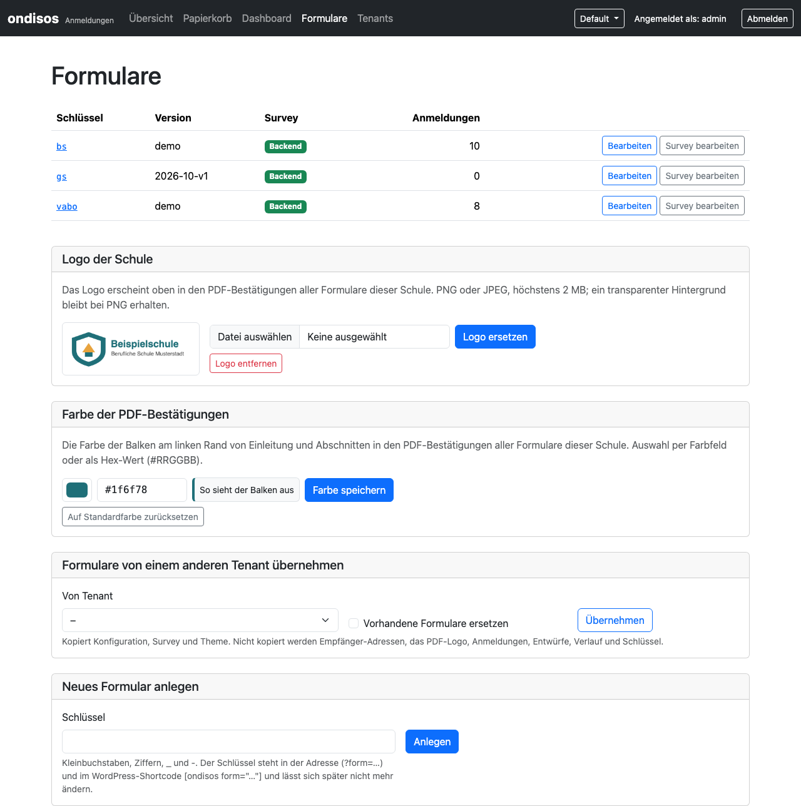
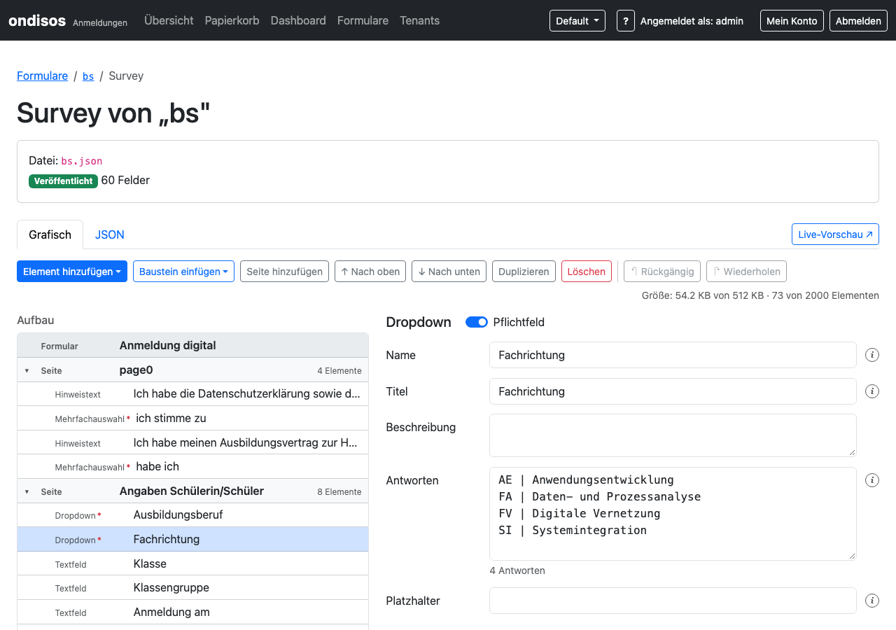
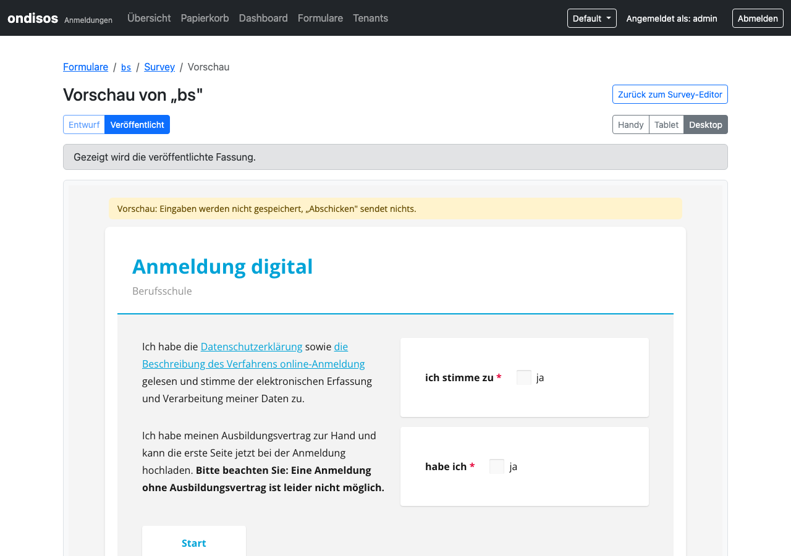
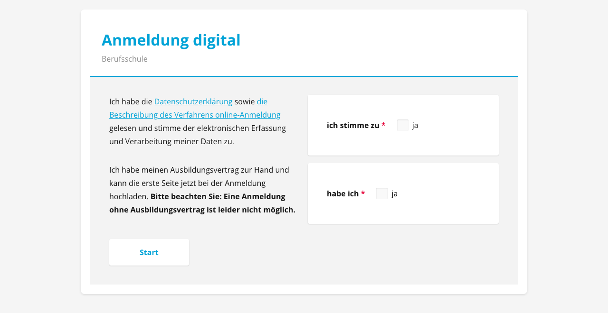
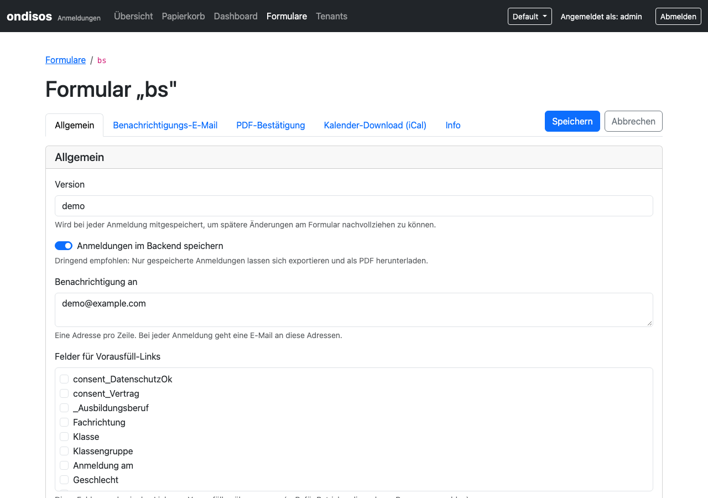
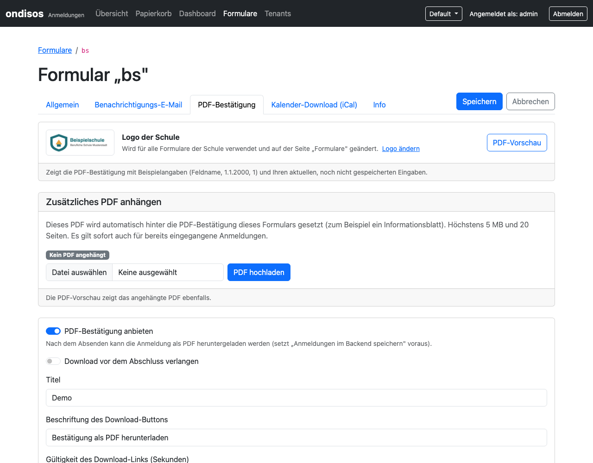

# Formulare erstellen und ändern

## Inhaltsverzeichnis

- [Überblick](#überblick)
- [Workflow im Backend](#workflow-im-backend)
  - [Neues Formular erstellen](#neues-formular-erstellen)
  - [Bestehendes Formular ändern](#bestehendes-formular-ändern)
  - [Was „Prüfen“ meldet](#was-prüfen-meldet)
  - [Vorschau](#vorschau)
  - [Live-Vorschau](#live-vorschau)
  - [Verlauf und Wiederherstellen](#verlauf-und-wiederherstellen)
- [Der grafische Editor](#der-grafische-editor)
  - [Aufbau und Eigenschaften](#aufbau-und-eigenschaften)
  - [Elemente hinzufügen, verschieben und löschen](#elemente-hinzufügen-verschieben-und-löschen)
  - [Bausteine](#bausteine)
  - [Antworten und Fragen in Antworten](#antworten-und-fragen-in-antworten)
  - [Feldnamen](#feldnamen)
  - [Einstellungen des Formulars](#einstellungen-des-formulars)
  - [Bedingungen und Berechnungen](#bedingungen-und-berechnungen)
  - [Was nur im Reiter „JSON“ geht](#was-nur-im-reiter-json-geht)
- [JSON und SurveyJS Creator](#json-und-surveyjs-creator)
  - [Lizenzhinweis](#lizenzhinweis)
- [Unterschriftsfelder](#unterschriftsfelder)
  - [Auf dem Smartphone unterschreiben](#auf-dem-smartphone-unterschreiben)
  - [Bestätigung ohne Unterschrift](#bestätigung-ohne-unterschrift)
- [Ausgeblendete Felder mit festem oder berechnetem Wert](#ausgeblendete-felder-mit-festem-oder-berechnetem-wert)
- [Design (Theme) ändern](#design-theme-ändern)
  - [Einstellungen und JSON](#einstellungen-und-json)
  - [Prüfen, Vorschau, Veröffentlichen](#prüfen-vorschau-veröffentlichen)
  - [Ältere Themes und eigene Schriften oder Bilder](#ältere-themes-und-eigene-schriften-oder-bilder)
- [Zusammenhang: Formular-Konfiguration ↔ Survey](#zusammenhang-formular-konfiguration--survey)
- [Surveys als Dateien (Fallback)](#surveys-als-dateien-fallback)

## Überblick

Ein Formular besteht aus zwei Teilen:

- der **Survey**: Seiten, Fragen und Texte, also das, was Besucher sehen. Gespeichert wird sie im offenen JSON-Format der SurveyJS Form Library, mit der Ondisos die Formulare anzeigt.
- der **Formular-Konfiguration**: Empfänger der Benachrichtigung, PDF-Bestätigung, Vorausfüll-Links usw.

Beides pflegen Schul-Admins im Backend unter **Formulare**. Surveys und Themes liegen in der Datenbank (pro Schule), das Frontend holt sie zusammen mit der Konfiguration vom Backend.

Die Survey bearbeiten Sie im **Survey-Editor** des Backends. Er hat zwei Reiter, die denselben Text bearbeiten:

- **Grafisch:** Seiten und Fragen anlegen, Eigenschaften und Antworten ändern, verschieben, Vorlagen und Bausteine nutzen, ohne JSON zu schreiben ([Der grafische Editor](#der-grafische-editor)).
- **JSON:** der vollständige Text, für alles, was die grafische Ansicht nicht anbietet, und zum Einfügen von JSON aus anderen Werkzeugen ([JSON und SurveyJS Creator](#json-und-surveyjs-creator)).

Eine Änderung im einen Reiter steht sofort im anderen. Gespeichert und veröffentlicht wird für beide gemeinsam.



## Workflow im Backend


### Neues Formular erstellen

1. **Formulare → Neues Formular anlegen**: **Schlüssel** eingeben (Kleinbuchstaben, Ziffern, `_` und `-`) und **Anlegen**. Der Schlüssel steht in der Adresse (`?form=<schlüssel>`) und im
   WordPress-Shortcode `[ondisos form="<schlüssel>"]` und lässt sich später nicht mehr ändern. Der Formular-Editor öffnet sich.
2. Im Reiter **Allgemein** die Konfiguration ausfüllen: **Benachrichtigung an** (Empfänger), **Anmeldungen im Backend speichern** (standardmäßig an), ggf. **Felder für Vorausfüll-Links**;
   weitere Reiter siehe [unten](#zusammenhang-formular-konfiguration--survey). Die Version steht zunächst auf `1.0.0`; Survey- und Theme-Datei (`<schlüssel>.json`, `survey_theme.json`) betreffen nur Plattform-Admins.
3. **Survey bearbeiten** (Button in der Formularliste oder im Reiter **Info**): Der leere Editor bietet **Mit einer Vorlage beginnen** an:

   | Vorlage | Inhalt |
   |---|---|
   | **Einfaches Formular** | eine Seite mit Name und E-Mail-Adresse als Pflichtfeldern; alles Weitere fügen Sie selbst hinzu |
   | **Rückmeldung** | Zusage ja/nein, Name, E-Mail-Adresse, Anmerkungen |
   | **Rückmeldung ohne E-Mail** | Zusage ja/nein, Name, Anmerkungen; datensparsam, ohne Rückfragen per E-Mail |
   | **Veranstaltung** | Teilnahme, Anzahl Personen, Name, E-Mail-Adresse, Anmerkungen; für eine Kalenderdatei in der Bestätigung den Reiter *Kalender-Download (iCal)* der Konfiguration nutzen |
   | **Schüleranmeldung** | Datenschutz, Angaben zur Person, Staatsangehörigkeit, Anschrift, Erziehungsberechtigte (nur bei Minderjährigen, Pflicht für die erste Person), Anmerkungen; Feldnamen und Auswahllisten für den [Import in ASV-BW](../sekretariat/ASV.md) |

   Darunter stehen **Beispiele aus einer Schule** (Berufsschule, Grundschule, VABO, Zusatzqualifikation Fachhochschulreife, Meisterschule). Sie zeigen, wie vollständige Anmeldungen aussehen;
   Links, Bildungsgänge und Texte stammen aus einer bestimmten Schule und müssen angepasst werden.

   Die gewählte Vorlage kommt in den Editor, gespeichert ist noch nichts. Zurück zur Auswahl kommen Sie, indem Sie im Reiter **JSON** den Text löschen.
4. Anpassen (siehe [Der grafische Editor](#der-grafische-editor)), mindestens den **Link zur Datenschutzerklärung** der Vorlage: Solange er auf `example.com` zeigt, meldet *Prüfen* einen Hinweis.
   Dann **Prüfen**, **Entwurf speichern**, **Vorschau** und **Veröffentlichen** wie bei einem [bestehenden Formular](#bestehendes-formular-ändern).
5. Einbetten: Standalone `…/index.php?form=<schlüssel>`, WordPress `[ondisos form="<schlüssel>"]`.

Im Reiter **Info** finden Sie außerdem den Verlauf der Konfiguration und **Formular löschen** (nur möglich, solange keine Anmeldungen zum Formular vorliegen).

Eine neue Schule kann stattdessen mit den Formularen einer anderen Schule beginnen (*Formulare übernehmen von …* beim Anlegen der Schule durch den Betreiber, siehe [MULTI-TENANT.md](../betreiber/MULTI-TENANT.md)).
Empfänger-Adressen und Logo werden dabei nie kopiert.

### Bestehendes Formular ändern

1. **Formulare** öffnen und beim Formular **Survey bearbeiten** wählen. Im Editor steht die veröffentlichte Fassung (oder, falls vorhanden, Ihr gespeicherter Entwurf). Er öffnet im Reiter **Grafisch**;
   hatte die letzte Prüfung Fehler, im Reiter **JSON**, weil die Fehler dort auf Zeilen zeigen.
2. Ändern, grafisch oder im JSON. Die **Live-Vorschau ↗** zeigt jede Änderung sofort, ohne Speichern ([Live-Vorschau](#live-vorschau)).
3. **Prüfen**: Was die Prüfung meldet, steht [unten](#was-prüfen-meldet); gespeichert oder veröffentlicht wird dabei nichts. Im grafischen Editor stehen die Meldungen auch am betroffenen Element.
4. **Entwurf speichern** (oder **Entwurf speichern & Vorschau**): Das veröffentlichte Formular bleibt unverändert. Pro Formular gibt es höchstens einen Entwurf; **Entwurf verwerfen** löscht ihn (nach Rückfrage).
5. **Vorschau** ansehen (siehe unten), danach **Veröffentlichen** (nach einer Rückfrage, denn die Änderung gilt sofort für alle Besucher). Unter dem Knopf lassen sich eine
   **Neue Formular-Version** (optional; leer lassen = unverändert) und eine **Anmerkung für den Verlauf** (optional) eintragen. Die Formular-Version wird mit jeder Anmeldung gespeichert,
   so lässt sich später nachvollziehen, nach welchem Stand ausgefüllt wurde.



Wurde die Survey zwischenzeitlich von jemand anderem veröffentlicht, bleibt Ihr Entwurf gespeichert, wird aber nicht veröffentlicht. Der Editor weist darauf hin und zeigt den Unterschied; nach der Prüfung lässt sich erneut veröffentlichen.

### Was „Prüfen“ meldet

| Bereich | Bedeutung |
|---|---|
| **Fehler** (blockieren Speichern und Veröffentlichen) | kein gültiges JSON (mit **Zeile und Spalte** und einem Link zur Stelle im Editor), zu groß, keine Fragen, Frage ohne `name`, doppelte oder reservierte Feldnamen (`_fieldTypes` und `website_url` nutzt das System selbst; `website_url` ist das unsichtbare Spamschutz-Feld, eine Frage mit diesem Namen würde nie ankommen), HTML außerhalb der erlaubten Auswahl, `javascript:`-Links |
| **Pflichtfelder für Ondisos** | Gespeicherte Anmeldungen brauchen einen **Namen** (Feld `Name` oder `name`) **oder** eine **E-Mail-Adresse** (`email`, `email1`, `Email`, `E-mail` oder `E-Mail`), mindestens eines davon als Pflichtfeld ohne Bedingung; sie erscheinen in Übersicht, Excel-Export und Benachrichtigungen. Die Standard-Anmeldung fragt **beides** ab. Bei einer Rückmeldung, die keine Rückfragen braucht (etwa zu einem Fest), kann die E-Mail-Adresse aus Datensparsamkeit entfallen; die Checkliste zeigt das andere Feld dann als „verzichtbar“. Fehlen beide, gibt es eine **Warnung**, aber keinen Fehler. Beim Absenden würde die Anmeldung dann **abgelehnt** |
| **Hinweise** | Warnungen, die nichts blockieren, z. B. Feldnamen im PDF-Filter, in Vorausfüll-Links oder im Mailtext, die es in der Survey nicht gibt (meist ein Tippfehler), und Bedingungen oder Ausdrücke, die auf ein Feld verweisen, das es nicht gibt (`{Alter}`, wo das Feld `age` heißt). SurveyJS behandelt ein solches Feld als leer: eine Frage mit *Sichtbar, wenn* erscheint nie, *Pflichtfeld, wenn* greift nie. Variablen, die SurveyJS selbst bereitstellt (`{item}`, `{panelIndex}`, `{row.…}`), gelten nicht als Feld. Außerdem Feldnamen in den Vorlagen dynamischer Panels (`paneldynamic`), die in einem zweiten dynamischen Panel oder außerhalb noch einmal vorkommen: Im Formular funktioniert das, der SurveyJS Creator meldet beim erneuten Öffnen aber „The name … is duplicated“ |
| **Änderungen an den Feldern** | neue sowie entfernte oder umbenannte Felder. Fehlende Felder fehlen künftig in neuen Anmeldungen, im Excel-Export, in Vorausfüll-Links und im PDF; bereits gespeicherte Anmeldungen behalten ihre Daten |
| **Unterschied zur veröffentlichten Fassung** | aufklappbar, mit Anzahl der hinzugefügten (+) und entfernten (−) Zeilen |

Wer Felder umbenennt (z. B. um für ASV passende Namen zu bekommen), sollte den Bericht zu entfernten und neuen Feldern lesen: Ein umbenanntes Feld ist für Excel-Export und PDF ein **neues** Feld.

### Vorschau

Die **Vorschau** (Button im Survey-Editor) zeigt Entwurf oder veröffentlichte Fassung so, wie Besucher das Formular sehen. Oben schalten Sie zwischen **Entwurf** und **Veröffentlicht** um
und wählen die Breite **Handy**, **Tablet** oder **Desktop**. Ein gelber Hinweis nennt, welche Fassung gezeigt wird („Gezeigt wird der Entwurf. Besucher sehen noch die veröffentlichte Fassung.“).
Über dem Formular wählen Sie jede Seite direkt aus (‹ Seitenauswahl ›), auch die Startseite; Pflichtfelder werden dabei nicht geprüft, Sie müssen also nicht erst alles ausfüllen.
Die Knöpfe des Formulars selbst prüfen wie bei Besuchern.
Eingaben werden nicht gespeichert, „Abschicken“ sendet nichts. Die Vorschau läuft in einem abgeschotteten Rahmen und ändert nichts am Live-Formular.



### Live-Vorschau

Der Knopf **Live-Vorschau ↗** rechts über dem Editor öffnet das Formular in einem eigenen Fenster. Es zeigt den Stand im Editor, auch **ohne Speichern**, und folgt jeder Änderung nach einem kurzen Moment:
grafisch, im Tab „JSON“ und beim Rückgängigmachen. Ihre Eingaben in der Vorschau und die gewählte Seite bleiben dabei stehen.
Mit großem Bildschirm legen Sie das Fenster neben den Editor; ein zweiter Klick auf den Knopf holt es wieder nach vorn.

- **Vom Editor zur Vorschau:** Wählen Sie im Aufbau ein Element, springt die Vorschau auf seine Seite und hebt es kurz mit einem Rahmen hervor.
- **Von der Vorschau zum Editor:** Mit dem Schalter **Auswählen** (oder mit gedrückter Alt-Taste) wählt ein Klick in die Vorschau das Element im Aufbau, statt das Formular auszufüllen. Das gilt für Fragen, Gruppen, Seiten und Antworten mit Fragen.
- **Ausgeblendete zeigen:** Elemente, deren Bedingung gerade nicht erfüllt ist, erscheinen dann trotzdem (blass). Ebenso die Fragen in Antworten, die nicht gewählt sind: Jede Antwort mit Fragen ist dann aufgeklappt. Ohne den Schalter prüfen Sie Bedingungen durch Ausfüllen.
- Die Vorschau zeigt nur, was die Prüfung des Servers erlaubt. Ist der Text gerade kein gültiges JSON oder lehnt die Prüfung ihn ab, bleibt der letzte gute Stand stehen und ein gelber Hinweis nennt den Grund.

Gespeichert wird dabei nichts: Speichern und Veröffentlichen bleiben im Editor. Das Theme (Farben, Schrift) kommt wie in der Vorschau aus dem Backend; ein geändertes Theme sehen Sie in der Live-Vorschau des [Theme-Editors](#prüfen-vorschau-veröffentlichen).

So sieht das Formular für Besucher aus:



### Verlauf und Wiederherstellen

Jede Veröffentlichung landet im **Verlauf** unterhalb des Editors (Tabelle mit *Wann*, *Anmerkung* und *Wer*; die letzten 50 Stände je Formular und Typ). Wird ein Formular zum ersten Mal im Backend geändert,
legt das System zuerst den bisherigen Stand als „Stand vor der Änderung“ ab. Mit **Wiederherstellen** (nach Rückfrage) wird ein früherer Stand zum aktuellen Formular; der Vorgang erscheint im Verlauf
als „Wiederhergestellt aus Revision #…“, nichts geht verloren. Die Konfiguration (Reiter **Info** im Formular-Editor) hat einen eigenen Verlauf.

## Der grafische Editor

Der Reiter **Grafisch** im Survey-Editor zeigt die Survey als Baum und ändert nur die Stelle im Text, die Sie bearbeiten. Alles andere bleibt Zeichen für Zeichen, wie es war,
auch Einstellungen, die die grafische Ansicht nicht kennt. Der Verlauf zeigt deshalb nur Ihre tatsächlichen Änderungen.

### Aufbau und Eigenschaften

Links steht der **Aufbau**: oben die Zeile **Formular** (Einstellungen der ganzen Survey), darunter die Seiten mit ihren Gruppen und Elementen, jeweils mit Typ und Titel.
Pflichtfelder tragen ein Sternchen hinter dem Typ. Seiten und Gruppen lassen sich auf- und zuklappen. Ein Element mit einer Meldung der letzten Prüfung ist markiert;
nach einer Änderung gelten die Meldungen als veraltet, bis Sie erneut prüfen.

Rechts stehen die **Eigenschaften** des gewählten Elements, je eine Zeile mit Bezeichnung und Eingabe. Was eine Eigenschaft bewirkt, erklärt das **(i)** dahinter
(Maus darüber; ein Klick hält die Erklärung offen). **Pflichtfeld** sitzt als Schalter neben der Überschrift. Selten gebrauchte Eigenschaften stehen in den Abschnitten
**Darstellung** sowie **Bedingungen und Berechnung**; sie klappen von selbst auf, wenn dort etwas eingetragen ist.

Eine Änderung gilt, sobald Sie das Feld verlassen oder Enter drücken. Enter in einem Feld sendet nie das Formular ab.

Über dem Aufbau zeigt der Editor die **Größe** der Survey (`Größe: … KB von 512 KB · … von 2000 Elementen`); das sind die Obergrenzen des Servers.

### Elemente hinzufügen, verschieben und löschen

**Element hinzufügen** öffnet eine Auswahl nach Gruppen:

| Gruppe | Elemente |
|---|---|
| Eingabe | Textfeld (mit *Eingabeart* für Datum, E-Mail, Zahl, Telefon …), Mehrzeiliger Text, Datei-Upload, Unterschrift |
| Auswahl | Dropdown, Mehrfach-Dropdown, Einfachauswahl, Mehrfachauswahl, Ja/Nein |
| Anzeige | Hinweistext (HTML aus einer erlaubten Auswahl, z. B. Absätze, Listen, Links) |
| Gruppierung | Gruppe (fasst Elemente zusammen, z. B. „Erziehungsberechtigte(r) 1“) |
| Berechnung | Berechnung (zeigt einen berechneten Wert, z. B. ein Alter) |

Das neue Element kommt hinter das gewählte Element, in eine gewählte Gruppe oder ans Ende der gewählten Seite. Es bekommt einen freien Namen (`question1`, `question2` …), den Sie danach
ändern können ([Feldnamen](#feldnamen)). **Seite hinzufügen** setzt eine neue Seite hinter die gewählte.

| Aktion | Knopf | Tastatur | Maus |
|---|---|---|---|
| Auswählen | | ↑ / ↓ | Klick |
| Auf- und zuklappen | | ← / → | Pfeil vor der Zeile |
| In die Eigenschaften / zurück zum Aufbau | | Enter / Esc | |
| Verschieben | **Nach oben**, **Nach unten** | Alt + ↑ / ↓ (am Rand einer Gruppe hinaus, am Rand einer Seite auf die vorige bzw. nächste) | Ziehen |
| In die Gruppe darüber / aus der Gruppe | | Alt + → / Alt + ← | auf die Gruppe ziehen / hinausziehen |
| Duplizieren | **Duplizieren** | Strg + D (Mac: ⌘ + D) | |
| Löschen | **Löschen** | Entf | |
| Rückgängig / Wiederholen | **Rückgängig**, **Wiederholen** | Strg + Z / Strg + Umschalt + Z oder Strg + Y (Mac: ⌘ + Z / ⌘ + Umschalt + Z) | |

Beim **Ziehen** mit der Maus gilt: auf die obere oder untere Hälfte eines Elements = davor bzw. dahinter, auf eine Gruppe = hinein, auf eine Seite = an ihren Anfang.
Eine Linie oder ein Rahmen zeigt das Ziel. Auf Tablets und Smartphones gibt es kein Ziehen; dort helfen die Knöpfe.

**Löschen** fragt nach und nennt, wie viele Elemente mitgelöscht werden und wie viele Bedingungen oder Texte auf das Element verweisen; diese passen Sie danach an.
**Duplizieren** setzt eine Kopie hinter das Original. Alle Namen in der Kopie sind neu (`Vorname_2`); Verweise innerhalb der Kopie zeigen auf die Kopie.

**Rückgängig** stellt den Text exakt wieder her, auch über viele Schritte (bis zu 100). In einem Eingabefeld gilt dessen eigenes Rückgängig; eine Änderung im Reiter **JSON** ist ein eigener Schritt.

### Bausteine

**Baustein einfügen** fügt eine fertige Gruppe von Feldern ein, deren Namen festliegen. Die Bausteine für Schulanmeldungen nutzen die Spaltennamen und Auswahllisten der Import-Vorlage von ASV-BW,
damit der Excel-Export ohne Nacharbeit importiert werden kann ([ASV-BW](../sekretariat/ASV.md)).

| Gruppe | Bausteine |
|---|---|
| **Schulanmeldung (Feldnamen für ASV-BW)** | Person · Staatsangehörigkeit, Sprache, Religion · Anschrift und Kontakt · Erziehungsberechtigte(r) 1 · Erziehungsberechtigte(r) 2 · Schulische Vorbildung · Ausbildungsbetrieb |
| **Allgemein** | Datenschutz-Zustimmung · Name und E-Mail · Unterschrift · Anmerkungen |

Was ein Baustein enthält, zeigt der Hinweis beim Darüberfahren. Er kommt als eigene Gruppe ans Ende der gewählten Seite oder hinter die gewählte Gruppe.

Die Namen eines Bausteins werden **nie** geändert: `Vorname_2` erkennt ASV nicht. Gibt es einen der Namen in der Survey schon, fügt der Editor den Baustein nicht ein und nennt die Felder.
Verwenden Sie dann das vorhandene Feld oder entfernen Sie es zuerst. Für die zweite erziehungsberechtigte Person gibt es deshalb einen eigenen Baustein (`Erz2…`).

Den Link im Baustein *Datenschutz-Zustimmung* ändern Sie auf die Datenschutzerklärung der Schule; solange er auf `example.com` zeigt, meldet *Prüfen* einen Hinweis.

### Antworten und Fragen in Antworten

Die **Antworten** einer Auswahl stehen eine pro Zeile. `Wert | Anzeigetext` trennt den gespeicherten Wert (er steht im Export und in Bedingungen) vom Text, den Besucher sehen.
Zeilen, die Sie nicht ändern, bleiben, wie sie waren.

Bei **Einfach-** und **Mehrfachauswahl** kann eine Antwort eigene Fragen enthalten, die das Formular erst zeigt, wenn diese Antwort gewählt ist (z. B. „Sonstiges“ → „Welche?“).
Unter der Antwortliste wählen Sie bei **Fragen zu einer Antwort** die Antwort und dann **Fragen hinzufügen**. Die Antwort erscheint im Aufbau unter ihrer Frage; neue Elemente aus der Werkzeugleiste kommen hinein,
solange sie gewählt ist, vorhandene ziehen Sie auf ihre Zeile. Ist die Antwort wieder leer, macht **Keine Fragen in dieser Antwort** sie zu einer einfachen Antwort.
Ändern Sie Wert oder Text einer solchen Antwort in der Antwortliste, bleiben ihre Fragen erhalten; fällt die Antwort weg, fragt der Editor nach.

### Feldnamen

Der **Name** eines Feldes ist der Schlüssel der Antworten: Er steht als Spalte im Excel-Export, im PDF, in Vorausfüll-Links und in Bedingungen. Der Editor leitet ihn nie aus dem Titel ab;
ändern Sie den Titel, bleibt der Name.

Benennen Sie ein Feld um, fragt der Editor nach: Für Excel-Export, PDF und Vorausfüll-Links ist es danach ein **neues** Feld; bereits gespeicherte Anmeldungen behalten ihre Daten unter dem alten Namen.
Verweise in Bedingungen und Texten (`{Name}`) passt der Editor dabei an. Die Formular-Konfiguration (PDF-Felder, Vorausfüll-Links, Mailtext) ändert er nicht; *Prüfen* meldet dort Namen, die es nicht mehr gibt.

Ein Name muss in der Survey eindeutig sein; `_fieldTypes`, `_consents` und `website_url` sind für das System reserviert.

**Einwilligungen** (Name beginnt mit `consent_`, z. B. `consent_DatenschutzOk` im Baustein *Datenschutz-Zustimmung*): Ist das Feld ein Pflichtfeld ohne Bedingung, prüft der Server beim Absenden,
dass es angekreuzt ist; eine Anmeldung ohne diese Einwilligung wird abgelehnt, auch wenn jemand das Formular umgeht. Gespeichert wird nur, **welche** Einwilligungen erteilt wurden
(Feld `_consents`), nicht das Häkchen selbst; in Liste, Export und Mail erscheinen Einwilligungen nicht. Einwilligungen mit Bedingung (*Sichtbar wenn*, *Aktiv wenn*, *Pflicht wenn*, auch an der Seite
oder Gruppe darüber) und in dynamischen Gruppen prüft der Server **nicht**, er vermerkt sie nur, wenn sie erteilt wurden. Eine Einwilligung, auf die Sie sich verlassen müssen, gehört deshalb ohne Bedingung ins Formular. Für Schulanmeldungen nehmen Sie am besten die [Bausteine](#bausteine), deren Namen ASV-BW kennt.

### Einstellungen des Formulars

Die Zeile **Formular** ganz oben im Aufbau bearbeitet die Einstellungen der ganzen Survey:

- **Allgemein:** Titel und Beschreibung (im Kopf des Formulars), **Text nach dem Absenden**, die Knöpfe **„Absenden“**, **„Weiter“**, **„Zurück“** und der Knopf auf der Startseite.
  Ein geleerter Knopftext bringt wieder den Standardtext.
- **Ablauf:** **Erste Seite ist Startseite**, **Cursor ins erste Feld**, **Angaben ausgeblendeter Felder** (siehe [Ausgeblendete Felder](#ausgeblendete-felder-mit-festem-oder-berechnetem-wert)).
- **Darstellung:** Position des Logos, Breite, Kopfbereich, Text beim Laden.

Farben und Schrift gehören nicht zur Survey, sondern zum [Theme](#design-theme-ändern).

### Bedingungen und Berechnungen

Im Abschnitt **Bedingungen und Berechnung** eines Elements stehen **Sichtbar, wenn**, **Pflichtfeld, wenn** und die Ausdrücke (**Vorgabewert durch Ausdruck**, **Wert setzen durch Ausdruck**, bei *Berechnung* **Ausdruck**).
Eine Bedingung bleibt Text, so wie Sie ihn tippen, etwa `{Unterrichtsform} = 'Vollzeitunterricht'`. Der Editor hilft beim Schreiben:

- **Vorschläge:** Nach `{` erscheinen die Felder mit ihrem Titel, nach einem Feld die Vergleiche (`=`, `!=`, `notempty`, `anyof` …), danach die Antworten des Feldes mit ihrem Text,
  nach einem vollständigen Vergleich `and` und `or`. ↑ / ↓ wählen, Enter oder Tab übernimmt, Esc schließt; Strg + Leertaste ruft die Vorschläge jederzeit auf.
- **Klartext:** Unter einer einfachen Bedingung steht, was sie bedeutet, z. B. *Bedeutet: „Unterrichtsform“ ist „Vollzeit“*. Bedingungen mit Klammern oder Funktionen bekommen keinen Klartext;
  ihre Wirkung zeigt die [Live-Vorschau](#live-vorschau) mit *Ausgeblendete zeigen*.
- **Warnungen** (sie blockieren nichts): ein Feld, das es nicht gibt, ein Wert, der keine Antwort des Feldes ist (mit den möglichen Werten), offene Klammern oder Anführungszeichen.
  Ein Verweis auf ein unbekanntes Feld ist der häufigste stille Fehler: Die Frage erscheint dann nie oder wird nie Pflicht. *Prüfen* meldet ihn ebenfalls.
- **Verwendet in:** Bei einem Feld nennt der Editor die Elemente, deren Bedingungen oder Texte darauf verweisen; ein Klick wählt sie aus.

Für Werte, die das Formular selbst ausfüllt, siehe [Ausgeblendete Felder mit festem oder berechnetem Wert](#ausgeblendete-felder-mit-festem-oder-berechnetem-wert).

### Was nur im Reiter „JSON“ geht

Die grafische Ansicht bearbeitet die gebräuchlichen Elementtypen und Eigenschaften. Alles andere bleibt unverändert erhalten und ist im Reiter **JSON** änderbar:

- **Andere Elementtypen**, etwa Matrizen oder dynamische Panels (wiederholbare Gruppen wie „weitere Berufstätigkeit“): Sie stehen mit ihrem Typ im Aufbau, lassen sich verschieben und löschen,
  aber nicht grafisch bearbeiten oder duplizieren.
- **Weitere Eigenschaften** eines Elements nennt der Editor unter den Eigenschaften („Weitere Eigenschaften (nur im Tab „JSON“ änderbar)“).
- **Weitere Sprachen:** Hat ein Titel Fassungen in mehreren Sprachen, bearbeitet der Editor die angezeigte und nennt die übrigen; sie bleiben unverändert.
- Berechnete Werte der ganzen Survey (`calculatedValues`) und Seiten in einer Survey, deren Elemente ohne Seiten direkt im Dokument stehen.

Ist der Text im Reiter **JSON** gerade kein gültiges JSON, sperrt der Editor die grafische Ansicht und nennt Zeile und Spalte des Fehlers.

## JSON und SurveyJS Creator

Der Reiter **JSON** zeigt den vollständigen Text der Survey in einem Code-Editor mit Zeilennummern und Fehlermarkierung. **Datei laden** holt eine JSON-Datei von Ihrem Rechner in den Editor,
**JSON kopieren** legt den Text in die Zwischenablage. Prüfen, Speichern und Veröffentlichen funktionieren wie im grafischen Editor.

Sie können eine Survey auch mit einem anderen Werkzeug entwerfen, das SurveyJS-JSON erzeugt, z. B. dem **SurveyJS Creator** auf der Website von SurveyJS (https://surveyjs.io/create-free-survey):
dort im *JSON Editor* einfügen, im *Designer* bearbeiten, das JSON zurückkopieren und im Reiter **JSON** ersetzen. Danach lässt sich die Survey grafisch weiterbearbeiten.
Der Creator kennt Elementtypen, die der grafische Editor nicht bearbeitet; die Prüfung des Servers gilt für beide Wege gleich.

### Lizenzhinweis

Die SurveyJS Form Library, mit der Ondisos die Formulare anzeigt, ist quelloffen (MIT); ihr Lizenzhinweis liegt den Dateien bei. Der grafische Editor von Ondisos ist eine eigene Entwicklung
und nutzt keinen Code des SurveyJS Creators. Der **Creator** ist proprietär lizenziert; er wird weder mitgeliefert noch in das Backend eingebunden, für seine Nutzung gelten die Bedingungen von SurveyJS
(https://surveyjs.io/licensing).

## Unterschriftsfelder

Der SurveyJS-Fragetyp `signaturepad` wird unterstützt. Die Unterschrift wird als Bild gespeichert und erscheint in der Detailansicht und in der PDF-Bestätigung; in der Excel-Ausgabe und in der Benachrichtigungs-Mail steht stattdessen der Platzhalter „[Unterschrift]“.

**Verwenden Sie das Format PNG** (`"dataFormat": "png"`, das ist die Voreinstellung von SurveyJS). Mit `"dataFormat": "jpeg"` wird der Hintergrund der Unterschrift schwarz, im Formular wie im PDF, weil JPEG keine Transparenz kennt.
SVG wird nicht angenommen.

Eine Unterschrift ist ein einfaches Bild, keine qualifizierte elektronische Signatur. Ob das für Ihren Zweck genügt, klären Sie mit Schulträger oder Datenschutzbeauftragten.

### Auf dem Smartphone unterschreiben

Mit der Maus zu unterschreiben ist mühsam. Ab 3.2.0a können Besucher am Rechner **„Auf dem Smartphone unterschreiben“** wählen:

1. Am Unterschriftsfeld erscheint ein QR-Code. Der Besucher scannt ihn mit Smartphone oder Tablet.
2. Auf dem Smartphone öffnet sich eine Seite mit Schulname, Formulartitel und dem Titel des Feldes und einer Unterschriftsfläche. Der Besucher unterschreibt und sendet.
3. Am Rechner erscheint die Unterschrift als Vorschau. Erst mit **Übernehmen** kommt sie ins Formular, **Verwerfen** erzeugt einen neuen Code.

Danach läuft alles wie bei einer Unterschrift mit der Maus (Detailansicht, PDF, Platzhalter in Excel und Mail).

**Einschalten:** *Formulare →* beim Formular *Bearbeiten →* Abschnitt *Allgemein →* „Unterschrift auf dem Smartphone anbieten“. Die Einstellung gilt für alle Unterschriftsfelder des Formulars; im Survey ändern Sie nichts.

Gut zu wissen:

- Der Button erscheint nur bei Unterschriftsfeldern im Format PNG und nur an Geräten mit Maus. Wer das Formular schon auf Smartphone oder Tablet ausfüllt, unterschreibt direkt im Feld.
- Ein QR-Code gilt **10 Minuten** und nur für eine Unterschrift. Bei mehreren Unterschriftsfeldern (z. B. Schüler/in und Erziehungsberechtigte) gibt es je Feld einen eigenen Code.
- Größe, Strich- und Hintergrundfarbe der Fläche auf dem Smartphone entsprechen dem Feld im Formular (`signatureWidth`, `signatureHeight`, `penColor`, `backgroundColor` bzw. Theme). Ein Feld im Querformat (Vorgabe 300 × 200) nutzt den Platz auf dem Smartphone am besten.
- Die Vorschau in *Formulare* zeigt den Button nicht, sie sendet nichts.
- Die Unterschrift ist dadurch **nicht rechtssicherer**: Sie bleibt ein gemaltes Bild, nur bequemer gezeichnet.

### Bestätigung ohne Unterschrift

Genügt Ihrer Schule eine Bestätigung, ist eine Checkbox mit getipptem Namen einfacher und hat denselben Beweiswert wie ein gemaltes Bild, zum Beispiel:

```json
{ "type": "checkbox", "name": "Bestaetigung", "title": "Bestätigung", "isRequired": true,
  "choices": [{ "value": "ja", "text": "Ich bestätige die Richtigkeit meiner Angaben." }] },
{ "type": "text", "name": "BestaetigtVon", "title": "Vor- und Nachname", "isRequired": true }
```

## Ausgeblendete Felder mit festem oder berechnetem Wert

Manche Angaben füllt das Formular selbst, etwa die Klasse aus der gewählten Unterrichtsform. Dafür dient ein ausgeblendetes Feld (*Sichtbar* aus) mit einem dieser Werte:

- **Vorgabewert:** ein fester Wert, z. B. `VABO`.
- **Vorgabewert durch Ausdruck** (`defaultValueExpression`): berechnet beim Öffnen und bei jeder Änderung der genannten Felder, z. B.
  `iif({Unterrichtsform} = 'Vollzeitunterricht', 'MV', 'MT')`. Eine eigene Eingabe in das Feld hätte Vorrang; bei einem ausgeblendeten Feld gibt es keine.
- **Wert setzen durch Ausdruck** (`setValueExpression`): berechnet ebenso, überschreibt aber auch eine eigene Eingabe.

Ausgeblendete Felder schickt SurveyJS normalerweise **nicht** mit: Die Einstellung *Angaben ausgeblendeter Felder* des Formulars (`clearInvisibleValues`) löscht sie
beim Absenden. Stellen Sie deshalb am Feld *Angabe, wenn ausgeblendet* auf **Behalten** (`"clearIfInvisible": "none"`):

```json
{
  "type": "text",
  "name": "Klasse",
  "visible": false,
  "defaultValueExpression": "iif({Unterrichtsform} = 'Vollzeitunterricht', 'MV', 'MT')",
  "clearIfInvisible": "none"
}
```

Stellen Sie stattdessen das ganze Formular auf *Behalten*, gehen auch Angaben mit, die Besucher eingegeben und danach durch eine andere Antwort wieder ausgeblendet haben.

## Design (Theme) ändern

Farben, Schrift, Ecken und Kartenstil der Formulare legt das **Theme** fest (ab Version 3.2). Ein Theme gilt für **alle Formulare der Schule, die es nutzen**; meist teilen sich alle Formulare das Theme `survey_theme.json`.
Schul-Admins und Plattform-Admins ändern es im Backend: **Formulare → Design (Themes) → Design bearbeiten**.

Die Liste zeigt jedes Theme, das ein Formular in seiner Konfiguration nennt, mit **Stand** und **Genutzt von**:

- **Im Backend:** Das Backend liefert dieses Theme an Frontend und WordPress-Plugin aus.
- **Noch nicht angelegt:** Ein Formular nennt das Theme, im Backend liegt aber keines. Das Formular nutzt dann die Datei im Frontend, falls vorhanden.
  Beim Bearbeiten steht die eingebaute Vorgabe im Editor; mit der ersten Veröffentlichung übernimmt das Backend.

Welches Theme ein Formular nutzt (*Theme-Datei* in der Konfiguration), ändern nur Plattform-Admins. Ein neues Theme entsteht, indem ein Plattform-Admin einen neuen Namen bei einem Formular einträgt;
es erscheint dann in der Liste als „Noch nicht angelegt“. Löschen lässt sich ein Theme nicht.

### Einstellungen und JSON

Oben stehen die üblichen **Einstellungen** als Felder, darunter das vollständige **Theme (JSON)**. Das JSON ist maßgeblich: Die Felder lesen daraus und schreiben hinein, alles andere im JSON bleibt unverändert.
Rückgängig (Strg+Z bzw. ⌘+Z im JSON) nimmt auch eine Änderung an einem Feld zurück. Ein leeres Feld bedeutet: Standard von SurveyJS.

| Feld | Wirkung |
|---|---|
| **Markenfarbe** | Buttons, Auswahl, Fokus und Links; helle und dunkle Töne leitet SurveyJS daraus ab. Hex (`#00a3d7`) oder `rgb(…)` |
| **Hintergrund** | die Fläche hinter den Fragen |
| **Formulartitel in der Markenfarbe** | der Titel folgt der Markenfarbe, auch wenn diese sich später ändert |
| **Fragen als Karten (mit Schatten)** | aus: Fragen ohne Kartenrahmen und Schatten |
| **Schrift** | Open Sans (mitgeliefert), Systemschrift oder eine eigene Angabe (siehe unten) |
| **Schriftgröße** | 14 bis 20 px |
| **Ecken (Radius in px)** | ein Wert für Karten, Buttons und Eingabefelder; 0 für eckig |
| **Hintergrundbild**, **Deckkraft**, **Bild anpassen** | Adresse eines Bildes, Deckkraft in Prozent, „Fläche füllen“, „Ganz zeigen“ oder „Originalgröße“ |

Liegt der Kontrast der Markenfarbe zu Weiß unter 4,5 : 1, erscheint ein Hinweis: Schrift auf Buttons und Links ist dann schwer lesbar (WCAG AA verlangt mindestens 4,5 : 1).
Das Blau der eingebauten Vorgabe liegt bei etwa 2,9 : 1; eine dunklere Markenfarbe ist barrierefreier.

Ist ein Wert im JSON so geschrieben, dass das Feld ihn nicht darstellen kann (etwa eine Farbe mit Transparenz oder vier unterschiedliche Radien), ist das Feld gesperrt und nennt den Wert; ändern Sie ihn dann im JSON.
Ist das JSON gerade nicht lesbar, sind alle Felder gesperrt, bis es wieder stimmt.

Alles, wofür es kein Feld gibt, ändern Sie im JSON. Ein Theme aus dem **SurveyJS Theme Editor** (Website, Reiter „JSON“) lässt sich dort einfügen und danach mit den Feldern nachjustieren.
**Auf Vorgabe zurücksetzen** ersetzt den Text im Editor durch die eingebaute Vorgabe; gespeichert wird dabei nichts.

### Prüfen, Vorschau, Veröffentlichen

1. **Prüfen** meldet Fehler mit Zeile und Spalte (kein gültiges JSON, kein Objekt, zu groß, HTML, `javascript:`- oder `data:`-Adressen) und Hinweise (Ressourcen von fremden Servern), zeigt den Unterschied zur veröffentlichten Fassung und nennt die betroffenen Formulare. Gespeichert wird nichts.
2. **Live-Vorschau ↗** öffnet ein Formular, das dieses Theme nutzt, in einem eigenen Fenster mit dem Theme aus dem Editor, auch ungespeichert, und folgt jeder Änderung. Oben wählen Sie das Formular;
   Formulare ohne veröffentlichte Survey im Backend lassen sich nicht wählen. Ist der Text gerade ungültig, bleibt der letzte gute Stand stehen und ein Hinweis nennt den Grund.
3. **Veröffentlichen** (mit optionaler **Anmerkung für den Verlauf**) prüft den Text, speichert ihn und macht ihn sofort in allen genannten Formularen sichtbar, im Frontend wie im WordPress-Plugin. Die Rückfrage nennt die betroffenen Formulare.

Einen gespeicherten Entwurf gibt es beim Theme nicht: Was nicht veröffentlicht ist, steht nur im Editor (beim Verlassen der Seite fragt der Browser nach).
Hat jemand anderes das Theme inzwischen veröffentlicht, wird Ihre Änderung nicht gespeichert; die Seite zeigt den Unterschied zum neuen Stand, danach lässt sich erneut veröffentlichen.

Der **Verlauf** unter dem Editor führt jede Veröffentlichung (der aktuelle Stand ist markiert) und wie beim Survey-Editor den Stand vor der ersten Änderung im Backend. **Wiederherstellen** macht nach Rückfrage einen früheren Stand wieder aktuell;
der bisherige Stand bleibt im Verlauf. Auch ein Import mit `--overwrite` (`import-surveys.php`, `copy-forms.php`) legt den alten Stand dort ab.

### Ältere Themes und eigene Schriften oder Bilder

**Ältere Themes:** Themes aus SurveyJS 2 (Variablen `--sjs-*`) funktionieren weiter; SurveyJS übersetzt Markenfarbe, Schrift, Schriftgröße und Radius. Titel, Kartenstil und Hintergrund folgen aber
den neuen Standardwerten von SurveyJS 3 (dunkler Titel, abgerundete Karten mit Rahmen, getönter Hintergrund). Ein Feld, dessen Wert aus dem älteren Format stammt, sagt das; beim Ändern stellt es die Angabe auf das neue Format (`--sjs2-*`) um.
Das alte Aussehen bekommen Sie am einfachsten mit **Auf Vorgabe zurücksetzen** und danach Ihrer Markenfarbe.

**Schriften:** Ein Theme kann keine Schrift laden. Mitgeliefert ist Open Sans; eine eigene Angabe (z. B. `Arial, sans-serif`) wirkt nur, wenn die Schrift auf dem Gerät der Besucher installiert ist.
Das Standalone-Frontend lädt Schriften ohnehin nur vom eigenen Server (Content-Security-Policy `font-src 'self'`).

**Bilder:** Legen Sie ein Hintergrundbild am besten auf den eigenen Server (z. B. `/bilder/hintergrund.jpg`). Ein Bild oder eine andere Ressource von einem fremden Server meldet **Prüfen** als Datenschutz-Hinweis:
Der Browser jeder Besucherin und jedes Besuchers fragt dann bei diesem Server an. Blockiert wird es nicht.

## Zusammenhang: Formular-Konfiguration ↔ Survey

Der Schlüssel der Formular-Konfiguration (`form_key`) bestimmt den URL-Parameter (`?form=<key>`) und den WordPress-Shortcode (`[ondisos form="<key>"]`). Die Konfiguration
verweist mit *Survey-Datei* und *Theme-Datei* auf die Survey und das Design-Theme (Name, z. B. `bs.json` und `survey_theme.json`); beides liegt als Ressource im Backend. Den Inhalt des Themes ändern Sie unter [Design (Theme) ändern](#design-theme-ändern).

Die Konfiguration wird im Formular-Editor (**Formulare → Bearbeiten**) in Reitern gepflegt: *Allgemein*, *Benachrichtigungs-E-Mail*, *PDF-Bestätigung*, *Kalender-Download (iCal)* und *Info*.



Für jedes Formular lassen sich konfigurieren:

- Empfänger einer Benachrichtigungs-Mail (**Benachrichtigung an**, mehrere Adressen möglich)
- ob die Daten in der Datenbank gespeichert werden (**Anmeldungen im Backend speichern**). Es ist auch denkbar, Anmeldungen nur per interner E-Mail entgegenzunehmen, ohne sie zu speichern. Das ist *nicht* empfohlen,
  da E-Mail-Benachrichtigungen nicht so zuverlässig sind wie ein Abspeichern. Ohne Speichern ist eine gültige Empfänger-Adresse **Pflicht**: Ohne Empfänger gingen die Daten
  verloren, deshalb zeigt das Frontend so ein Formular nicht an.
- ob ein PDF-Download nach dem Absenden angezeigt wird (Logo und Farbe der Schule, optional ein angehängtes PDF, PDF-Vorschau): siehe [PDF-Bestätigung gestalten](pdf-bestaetigung.md)
- ob Teile des Formulars als Link vorausgefüllt weitergegeben werden können (**Felder für Vorausfüll-Links**; für Firmen, die regelmäßig Auszubildende anmelden). Wer den Link hat, sieht diese Angaben: nur Felder wählen, die weitergegeben werden dürfen (Betriebsdaten, keine Angaben zur Person)
- ein **Kalender-Download** (iCal) nach dem Absenden und der **Einleitungstext der Benachrichtigungs-E-Mail**



⚠️ **Wichtig:** Es ist kein E-Mail-Versand der Formulardaten an den Benutzer vorgesehen, da diese unverschlüsselt übermittelt würden. Soll der Benutzer eine Bestätigung
erhalten, muss die PDF-Bestätigung aktiviert werden: Sie wird TLS-verschlüsselt (über https) an das Endgerät übertragen.

Die Konfiguration lässt sich auch per Skript einspielen: `php backend/seed-forms.php [--tenant=<slug>]` (fügt neue Formulare hinzu, überschreibt vorhandene nie, prüft jeden
Eintrag; Vorlage: [frontend/config/forms-config-dist.php](../../frontend/config/forms-config-dist.php)), siehe [MIGRATION-3.0.md § 6](../betreiber/MIGRATION-3.0.md#6-danach-formular-konfiguration-ändern).

## Surveys als Dateien (Fallback)

Bis zur Version 3.0 lagen die Surveys als JSON-Dateien im Frontend (`frontend/surveys/`). Das funktioniert weiterhin als **Fallback**: Liefert das Backend für den Namen keine
Survey, nutzt das Frontend die Datei. Sobald eine Survey im Backend liegt, hat sie Vorrang; wer beides pflegt, sieht die Datenbank-Fassung.

Vorhandene Dateien lassen sich in die Datenbank übernehmen:

```bash
php backend/import-surveys.php [--tenant=<slug>] [--overwrite] [--dry-run] frontend/surveys

# Docker: der Container sieht frontend/ nicht, das Verzeichnis zuerst hineinkopieren
docker compose cp frontend/surveys backend:/tmp/surveys
docker compose exec backend php import-surveys.php /tmp/surveys
```

Für Themes ist der Import nur noch für die Übernahme gedacht; danach ändern Sie das Design im Backend ([Design (Theme) ändern](#design-theme-ändern)). Ein späterer Import mit `--overwrite` ersetzt die Fassung aus dem Backend; der alte Stand liegt dann im Verlauf des Themes.

Details und Upgrade-Hinweise: [MIGRATION-3.1.md](../betreiber/MIGRATION-3.1.md). Der Datei-Fallback soll später entfallen (kein Termin); die Dateien bleiben dann nur Importquelle.
