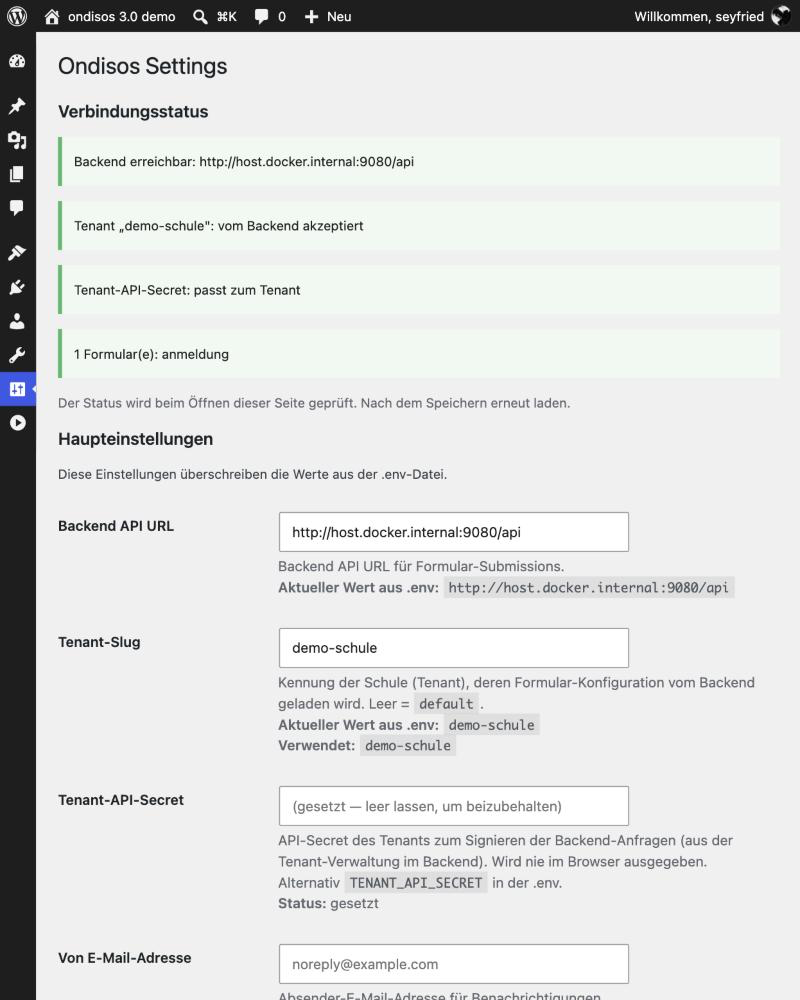

# WordPress-Plugin installieren

Das Plugin **ondisos** bindet die Anmeldeformulare per Shortcode in Seiten Ihrer WordPress-Website ein:

```
[ondisos form="bs"]
```

Die Formulardaten werden **nicht** in WordPress gespeichert: Das Plugin leitet sie serverseitig und signiert an das Ondisos-Backend weiter, das Ihr Schulträger bzw. Medienzentrum betreibt.
Wie beide Teile zusammenspielen: [Betriebsmodell](../docs/betreiber/betriebsmodell.md).

Diese Anleitung beschreibt die Installation mit der **fertigen ZIP-Datei**, ohne Kommandozeile. (Installation aus dem Git-Repository für Entwickler und eigene Server: [INSTALL-AUS-GIT.md](INSTALL-AUS-GIT.md).)

## Inhalt

1. [Was Sie brauchen](#was-sie-brauchen)
2. [Installieren](#installieren)
3. [Einstellungen](#einstellungen)
4. [Formular einbinden](#formular-einbinden)
5. [Testen](#testen)
6. [Aktualisieren](#aktualisieren)
7. [Fehlersuche](#fehlersuche)
8. [Unterschrift per Smartphone](#unterschrift-per-smartphone)
9. [Deinstallation](#deinstallation)
10. [Sicherheitshinweise](#sicherheitshinweise)

---

## Was Sie brauchen

**Von Ihrem Betreiber (Schulträger, Medienzentrum)**, der Ihre Schule im Backend angelegt hat:

- die **Backend-Adresse** (API), z. B. `https://backend.example.org/api`
- den **Tenant-Slug**, die Kennung Ihrer Schule, z. B. `bsz-karlsruhe`
- das **Tenant-API-Secret** (ein langer Schlüssel; er wird beim Anlegen nur einmal angezeigt)
- den **Schlüssel** der Formulare, die Sie einbinden wollen, z. B. `bs` (nennt Ihnen die Redaktion Ihrer Schule)

**Auf Ihrer Website:** WordPress 5.8 oder neuer, PHP 8.1 oder neuer mit der Erweiterung `curl`. Der **WordPress-Server muss das Backend erreichen können** (die Anfragen kommen vom Server, nicht aus dem Browser der Besucher).
Das Plugin benötigt ein Ondisos-Backend ab Version 3.0; Surveys aus dem Backend und der erweiterte Verbindungsstatus brauchen Backend 3.1. Aktuelle Plugin-Version: **3.1.2** (braucht für das neue Signaturformat ein Backend ab 3.1.2; **zuerst das Backend aktualisieren**). Die Uhr des WordPress-Servers muss stimmen (NTP): bei mehr als 5 Minuten Abweichung zum Backend lehnt dieses die Anfragen ab.

## Installieren

1. **ZIP herunterladen:** Auf der [Releases-Seite](https://gitlab.hhs.karlsruhe.de/digitale-schulverwaltung/ondisos/-/releases) steht die Datei `ondisos-<version>.zip` unter *Assets* („WordPress plugin (ZIP)“).
   **Direkter Download der neuesten Version:** [ondisos-plugin.zip](https://gitlab.hhs.karlsruhe.de/digitale-schulverwaltung/ondisos/-/releases/permalink/latest/downloads/ondisos-plugin.zip) (die Adresse bleibt bei jedem Release gleich); die Beschreibung der Version steht unter [Neuestes Release](https://gitlab.hhs.karlsruhe.de/digitale-schulverwaltung/ondisos/-/releases/permalink/latest).
   Daneben liegt die Prüfsumme ([ondisos-plugin.zip.sha256](https://gitlab.hhs.karlsruhe.de/digitale-schulverwaltung/ondisos/-/releases/permalink/latest/downloads/ondisos-plugin.zip.sha256); optional, Datei und Prüfsumme in einen Ordner legen und `shasum -a 256 ondisos-plugin.zip` mit dem Wert vergleichen).
2. In WordPress: *Plugins → Installieren → Plugin hochladen*, die ZIP wählen, **Jetzt installieren**, dann **Plugin aktivieren**.
   Der Eintrag heißt „ondisos - Onboarding Digital Souverän + Open Source“.

Die ZIP ist für alle Schulen gleich und enthält keine Zugangsdaten; es ist nichts weiter zu kopieren. Den Formular-Cache (siehe unten) legt WordPress selbst unter `wp-content/uploads/ondisos-cache/` an.

## Einstellungen

*Einstellungen → Ondisos*. Oben steht der **Verbindungsstatus** (wird beim Öffnen geprüft): ob das Backend antwortet, ob der Tenant akzeptiert wird, ob ein Secret gesetzt ist und wie viele Formulare es gibt.



| Feld | Eintrag |
|---|---|
| **Backend API URL** | die Adresse vom Betreiber, z. B. `https://backend.example.org/api` |
| **Tenant-Slug** | Kennung Ihrer Schule; leer = `default` (nur bei einer Einzelinstallation sinnvoll) |
| **Tenant-API-Secret** | der Schlüssel vom Betreiber. Er wird nach dem Speichern **nie wieder angezeigt**; leer lassen bedeutet „unverändert“ |
| **Von E-Mail-Adresse** | Absender der Benachrichtigungs-E-Mails an die Schule |
| **Vertrauenswürdige Proxys** | Nur bei einem Reverse-Proxy vor WordPress: IPs/CIDR (kommagetrennt), deren `X-Forwarded-For` für die Client-IP der Anmeldung gilt. Leer = Header ignoriert. Siehe [Betrieb](../docs/betreiber/betrieb.md#reverse-proxy-client-ip-und-rate-limit) |

Beim **Speichern** einer URL, unter der das Backend nicht antwortet, erscheint eine Warnung (die URL wird trotzdem gespeichert). Ob das Secret zum Tenant passt, zeigt der Verbindungsstatus
(„Secret passt zum Tenant“, ab Backend 3.1) bzw. spätestens das erste Absenden.

**WordPress läuft selbst in Docker?** Dann ist `localhost` der Container, nicht Ihr Rechner, und `http://localhost:9080/api` findet das Backend nicht. Das Plugin warnt in diesem Fall. Passende Adressen:

| Aufbau | Backend API URL |
|---|---|
| Backend auf demselben Docker-Host, über einen Port veröffentlicht (Docker Desktop: Mac/Windows) | `http://host.docker.internal:9080/api` |
| Dasselbe unter Linux | im WordPress-Dienst `extra_hosts: ["host.docker.internal:host-gateway"]` eintragen, dann wie oben |
| WordPress und Backend teilen ein Docker-Netzwerk | `http://<dienstname>/api`, z. B. `http://backend/api` |
| Backend auf einem anderen Server | dessen Adresse, z. B. `https://backend.example.org/api` |

## Formular einbinden

Neue Seite (oder Beitrag) anlegen und den **Shortcode** einfügen, mit dem Schlüssel des Formulars:

```
[ondisos form="bs"]
```

`form` ist Pflicht und muss ein Formular sein, das im Backend für Ihre Schule existiert. Ein Attribut für die Schule gibt es nicht: Sie gehört zur Installation (Einstellungen), nicht zur Seite.
Mehrere Shortcodes auf einer Seite sind möglich.

**Vorausfüllen:** Felder lassen sich per Link vorbelegen, entweder mit `?prefill=<base64-JSON>` (den Link erzeugt das System nach einer Anmeldung) oder einfach per Parameter, z. B. `…/anmeldung/?Vorname=Erika&Klasse=5a`.
Übernommen werden nur Parameter, die als Feldname im Formular existieren (Tracking-Parameter wie `utm_source` werden ignoriert).

## Testen

1. Die Seite aufrufen: Das Formular erscheint.
2. Eine **Testanmeldung** absenden. Im Backend (Sekretariat) erscheint ein Eintrag mit Status *Neu*; die PDF-Bestätigung (falls aktiviert) lässt sich herunterladen.
3. Die Testanmeldung im Backend wieder löschen (Papierkorb).

Checkliste:

- [ ] Plugin ist aktiviert, *Einstellungen → Ondisos* öffnet sich, Verbindungsstatus ohne Warnung
- [ ] Der Shortcode zeigt das Formular (keine Meldung „Unknown form“), Schrift und Layout laden
- [ ] Absenden funktioniert, der Eintrag ist im Backend
- [ ] PDF-Download, Datei-Upload und Vorausfüll-Link funktionieren (falls eingerichtet)

## Aktualisieren

1. Die neue ZIP laden: [ondisos-plugin.zip](https://gitlab.hhs.karlsruhe.de/digitale-schulverwaltung/ondisos/-/releases/permalink/latest/downloads/ondisos-plugin.zip) (neueste Version) oder von der [Releases-Seite](https://gitlab.hhs.karlsruhe.de/digitale-schulverwaltung/ondisos/-/releases).
2. *Plugins → Installieren → Plugin hochladen*, die ZIP wählen und, wenn WordPress nachfragt, **Aktuelles durch hochgeladenes ersetzen**.
3. Bei aktiven Cache-Plugins den Cache leeren.

Ihre Einstellungen bleiben erhalten (sie liegen in der WordPress-Datenbank). Das Backend muss zuerst aktualisiert sein: Das Plugin 3.1.2 signiert im neuen Format, das erst ein Backend ab 3.1.2 versteht (ein Plugin bis 3.1.1 läuft dagegen auch an einem Backend 3.1.2 weiter).
Beim Wechsel von einer 2.x-Installation: [MIGRATION-3.0.md](../docs/betreiber/MIGRATION-3.0.md) (Tenant-Slug und Secret eintragen).

## Fehlersuche

Melden Sie sich als **Administrator** an und sehen Sie die Seite mit dem Formular an: Fehlermeldungen nennen dann Ursache und Adresse (Besucher sehen nur eine neutrale Meldung).
Zusätzlich zeigt *Einstellungen → Ondisos* den Verbindungsstatus.

| Symptom | Ursache und Lösung |
|---|---|
| `Error: The form is currently unavailable` (Besucher) bzw. `Error (shown to administrators only): …` | Backend nicht erreichbar, Schule abgelehnt oder unerwartete Antwort. Backend-URL und Slug prüfen; vom **WordPress-Server** aus testen: `curl "<Backend-URL>/health.php"` |
| `Error: Unknown form "bs"` | Das Backend kennt das Formular für Ihre Schule nicht: Schlüssel im Shortcode richtig? Wurde das Formular angelegt? (Redaktion oder Betreiber fragen) |
| Absenden: „Unauthorized“ | Tenant-API-Secret fehlt oder passt nicht zum Backend; ggf. wurde der Schlüssel erneuert, dann neuen Wert beim Betreiber erfragen. Ab 3.1.2 auch: die **Uhr des WordPress-Servers** weicht um mehr als 5 Minuten vom Backend ab, oder das Backend ist älter als 3.1.2 |
| Besucher sehen „Erfolg“, die Anmeldung fehlt im Backend | Der Spamschutz hat ausgelöst (`ondisos - honeypot triggered` im `debug.log`): Bot, ein Browser-Plugin, das alle Felder ausfüllt, oder eine Survey-Frage mit dem Feldnamen `website_url` (Redaktion muss sie umbenennen) |
| `Error: the shortcode could not be read, probably a missing or doubled quotation mark` | Der Shortcode ist falsch geschrieben, z. B. `[ondisos form=""bs]`: die Meldung zeigt den empfangenen Text; richtig ist `[ondisos form="bs"]` |
| Absenden: „Backend-Zugang nicht konfiguriert“ | Es ist kein Tenant-API-Secret eingetragen |
| Formular lädt, PDF-Link schlägt fehl | Backend-URL und Erreichbarkeit vom WordPress-Server aus prüfen |
| Formular zeigt eine alte Fassung | Das Plugin fragt bei jedem Aufruf das Backend ab; eine alte Fassung erscheint nur, solange das Backend nicht erreichbar ist (der Cache hält bis zu 7 Tage). Erreichbarkeit prüfen; im Zweifel `wp-content/uploads/ondisos-cache/` leeren |
| Cache-Verzeichnis nicht beschreibbar | Das Plugin arbeitet dann ohne Cache; Schreibrechte auf `wp-content/uploads` prüfen |
| Kein Button „Auf dem Smartphone unterschreiben“ | Option beim Formular aus (Redaktion), Feld nicht im Format PNG, oder Gerät mit Touchscreen als Haupteingabe (dort wird direkt im Feld unterschrieben) |
| Dialog oder Smartphone: „Der Dienst ist gerade nicht erreichbar“ | Antwortet `admin-ajax.php?action=ondisos_sig` mit `502` und `{"ok":false,"error":"unavailable"}`, liegt die Ursache zwischen WordPress und Backend: Im `debug.log` steht `Signature handoff (…): backend HTTP …`, die Bedeutung erklärt [Meldungen der Unterschrift per Smartphone](../docs/schul-it/standalone-frontend.md#meldungen-der-unterschrift-per-smartphone). Ist die Antwort eine HTML-Seite oder `403`, blockiert eine Sicherheits-Erweiterung (siehe [Unterschrift per Smartphone](#unterschrift-per-smartphone)) |
| Dialog: „Die Seite ist veraltet …“ | Die Seite stammt aus einem Seiten-Cache und ihr Nonce ist abgelaufen (wie beim Absenden): Formularseiten vom Cache ausnehmen oder die Cache-Dauer unter 12 Stunden halten |

Mehr Details liefert das WordPress-Debug-Log (`define('WP_DEBUG', true); define('WP_DEBUG_LOG', true);` in der `wp-config.php`, Ausgabe in `wp-content/debug.log`) und im Browser der Reiter *Netzwerk*
(Antwort von `admin-ajax.php?action=ondisos_submit`).

## Unterschrift per Smartphone

Schaltet die Redaktion bei einem Formular „Unterschrift auf dem Smartphone anbieten“ ein (ab 3.2.0a), zeigt das Formular an Unterschriftsfeldern einen QR-Code; unterschrieben wird auf dem Smartphone.
Das Plugin nutzt dafür zwei weitere Aktionen von `admin-ajax.php`, beide für Besucher ohne Anmeldung:

| Adresse | Aufgabe |
|---|---|
| `wp-admin/admin-ajax.php?action=ondisos_sign` | Seite auf dem Smartphone (der QR-Code zeigt dorthin; eigene Seite ohne Theme) |
| `wp-admin/admin-ajax.php?action=ondisos_sig` | Vermittlung zwischen Browser und Backend (POST mit JSON) |

`admin-ajax.php` muss ohnehin öffentlich erreichbar sein, denn auch Absenden und PDF-Download laufen darüber. Wer `/wp-admin/` per Webserver-Regel auf interne Adressen beschränkt,
lässt `admin-ajax.php` davon aus (die übliche Ausnahme der Härtungsanleitungen).

**Sicherheits-Erweiterungen (z. B. Wordfence):** Die neuen Anfragen sehen für eine Web Application Firewall ungewöhnlich aus:

- Die Formularseite fragt `action=ondisos_sig` während des Unterschreibens **alle 3 Sekunden** ab (höchstens 10 Minuten). Ein Rate-Limit der Firewall für `admin-ajax.php` darf das nicht treffen.
- Das Smartphone sendet die Unterschrift als **Base64-Bild im JSON-Body** (bis etwa 200 KB); Regeln gegen „verdächtige Payloads“ können anschlagen.
- `action=ondisos_sign` liefert eine vollständige HTML-Seite aus, keine JSON-Antwort.

Blockiert die Firewall, sehen Besucher „Der Dienst ist gerade nicht erreichbar“. Prüfen Sie dann das Protokoll der Firewall (bei Wordfence: *Live Traffic* bzw. die Liste blockierter Anfragen)
und geben Sie die beiden Aktionen frei (bei Wordfence über die Ausnahmeliste der Firewall, *Allowlisted URLs*, mit dem Pfad `/wp-admin/admin-ajax.php` und dem Parameter `action`).
Testen Sie danach einmal mit einem Smartphone im **Mobilfunknetz**, nicht im WLAN der Schule.

Die Adresse im QR-Code ist die WordPress-Adresse der Website (*Einstellungen → Allgemein*); sie muss von außen erreichbar sein.

## Deinstallation

Plugin in WordPress **deaktivieren und löschen**: Dabei entfernt das Plugin seine Einstellungen (`ondisos_backend_url`, `ondisos_from_email`, `ondisos_trusted_proxies`, `ondisos_tenant_slug`, `ondisos_tenant_api_secret`).
Die Anmeldedaten liegen im Backend und bleiben unberührt.

## Sicherheitshinweise

- ✅ CSRF-Schutz über WordPress-Nonces; Ausgaben werden escaped.
- ✅ Anfragen ans Backend sind pro Schule signiert (HMAC-SHA256); das Secret verlässt den Server nie.
- ✅ Das Secret-Feld der Einstellungen ist schreibgeschützt (wird nie ins HTML zurückgegeben).
- ⚠️ **Das Secret liegt im Klartext in `wp_options`:** Datenbank-Zugriff und Backups von WordPress schützen.
  *Auswirkung im Ernstfall:* Wer das Secret erhält, kann im Namen Ihrer Schule Anmeldungen und Datei-Uploads an das Backend senden (**Schreibzugriff**, vom Rate-Limit gebremst).
  Anmeldedaten **lesen** kann er damit nicht, es sind keine Daten kompromittiert. Abhilfe: Der Betreiber erneuert den API-Schlüssel im Backend (der alte ist sofort ungültig), Sie tragen den neuen ein.
- ⚠️ Die Backend-Adresse in Produktion mit **HTTPS** (die Signaturen enthalten keinen Zeitstempel).
- ⚠️ Upload-Größen im Backend sind begrenzt (`UPLOAD_MAX_SIZE`); der Virenscan läuft im Backend.

## Mehrere WordPress-Websites

Dieselbe ZIP lässt sich auf mehreren Websites installieren. Jede Website hat **eigene** Einstellungen, bei verschiedenen Schulen jeweils mit dem passenden Tenant-Slug und -Secret.
Mehr zum Betrieb mehrerer Schulen: [MULTI-TENANT.md](../docs/betreiber/MULTI-TENANT.md).

## Weitere Informationen

Funktionen und Aufbau: [README.md](README.md) · Installation aus dem Git-Repository: [INSTALL-AUS-GIT.md](INSTALL-AUS-GIT.md) · Dokumentation: [docs/README.md](../docs/README.md) · Lizenz: MIT ([LICENSE](../LICENSE))
